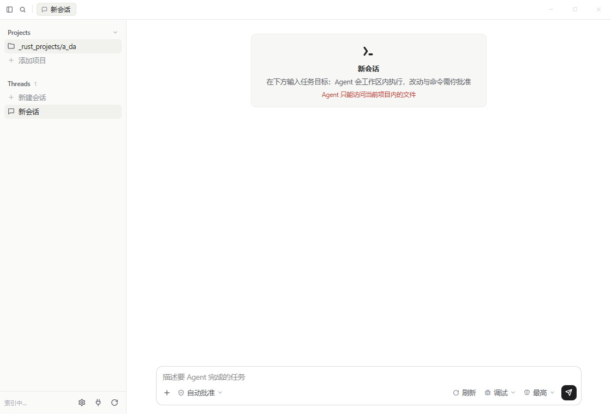

# a_da

> **状态（2026-10-18）**：纯 Rust 微内核 + 节点/桥接/网关三层 + Electron 桌面壳。
> 本文描述**当前**实现；**文档按功能域整理过**，入口是 [docs/README.md](docs/README.md)。
>
> 历史 TypeScript 实现（Bun 宿主 + GPUIX 客户端 + TS 侧 agent）已于 2026-10-17 整体删除，
> 不再是参考设计、不参与构建与测试；当时的设计与计划文档也已从 `docs/` 移除
> （需要考古：`git log --diff-filter=D --name-only -- docs/`）。
> 现行的设计与约定口径是 [docs/architecture/kernel-design.md](docs/architecture/kernel-design.md)
> 与 [docs/architecture/conventions.md](docs/architecture/conventions.md)。


一个**本地** AI 编码 Agent 的桌面程序：纯 Rust 内核 + Electron 桌面壳 + React 前端。
标志是一条 shell 提示符 `>_`——Agent 就是在工作区里跑命令的那个东西，
方块的落点正好是名字里那条下划线。



## 目录

- [架构](#架构)
- [它做什么](#它做什么)
- [一轮对话是怎么跑的](#一轮对话是怎么跑的)
- [审批与取消](#审批与取消)
- [子智能体](#子智能体)
- [检查点与回滚](#检查点与回滚)
- [插件与钩子](#插件与钩子)
- [网关与桌面壳](#网关与桌面壳)
- [运行](#运行)
- [代码结构](#代码结构)
- [门禁与测试](#门禁与测试)
- [已知限制](#已知限制)

---

## 架构

**微内核**：`crates/agent-base` 是零 IO、零产品名词的领域层——领域类型、**13 个端口**、
以及**唯一**的多轮循环 `AgentRuntime::run_turn`（INV-1）。它不知道文件系统、
不知道产品叫什么、不知道界面长什么样。

**依赖方向**（单向，无环）：

```
agent-base ─► agent-proto / agent-adapter / agent-toolkit / agent-runtime ─► agent-host
                                                                              ↓
                                                        agent-node ─► agent-rpc ─► 产品 / 网关
```

| 层 | 位置 | 职责 |
|---|---|---|
| 领域与端口 | `crates/agent-base` | 消息 / 工具描述符与回执 / 事件 / 错误与失败方向；**13 个端口**；**单一引擎** `run_turn`；诊断点位词汇表 |
| 线协议 | `crates/agent-proto` | JSON-RPC 帧、**77 个方法常量**、线上 DTO、错误码、client-ts |
| 适配器 | `crates/agent-adapter` | 三家协议 SSE（OpenAI Chat / Anthropic / OpenAI Responses）、会话落盘、提示词排版、作用域、时钟 |
| 工具包 | `crates/agent-toolkit` | **22 个工具描述符（单一真源）** + `core`/`fs`/`command`/`git`/`project`/`forge` 六个工具包 |
| 组合根 | `crates/agent-runtime` | `ProductBuilder`、产品声明（`AgentSpec`）、贡献与工具目录 |
| 宿主装配 | `crates/agent-host` | 按产品声明装配引擎 + 会话 + 审批 + 贡献（`ContributionPolicy`） |
| **节点** | `crates/agent-node` | 会话 / 审批 / 检查点 / 子智能体 / 插件 / 技能 / 脚本 / **钩子运行时**（不含协议管道与 UI 投影） |
| **桥接面** | `crates/agent-rpc` | JSON-RPC 分发（77 方法）、WS 宿主、快照合帧、`AgentStore`（给界面看的投影）、引擎调用 |
| **网关** | `crates/agent-gateway` | `ada-gateway`：实例注册与监督、跨进程委派与续跑、路由透传、鉴权（token / 作用域 / Origin / 配对码） |
| 合规套件 | `crates/agent-conformance` | 端口契约 + 跨端口不变量 + golden 回放夹具 |
| 插件运行时 | `crates/ts-engine` | Boa + oxc 的 TS 沙箱（插件代码在自己的进程内或子进程里跑） |
| 产品 | `products/ada-coding`（含 `modes/pm.agent.spec.json` 预设）、`products/ada-skeleton` | 声明式产品（`agent.spec.json` + 极小 `main`） |
| 桌面宿主 | `electron/` + `desktop-ui/` | Electron 壳（网关监督、窗口控制、IPC 桥接）+ React 界面（`ws-client.ts` 是唯一协议客户端） |

**产品声明式装配**：`products/*/agent.spec.json` 声明 `toolkits` / `capabilities` /
`identity` / `policies`，`agent-host` 按声明装配。声明的每个字段都有**真实消费者**
（`cargo xtask verify-spec` 会逐个核对）：

| 声明字段 | 消费者 |
|---|---|
| `toolkits` | `tools_for_toolkits` → 工具目录（子智能体也走同一处装配） |
| `capabilities.subagents` | 是否装配 `invoke_subagent` |
| `capabilities.images` | 声明 `false` → 拒绝图片输入（模型认不认图另由 `ModelEntry.supportsImages` 表达） |
| `capabilities.plugins` / `hooks` | 是否装配插件平台与钩子点位 |
| `identity.name` / `.persona` / `.locale` | 系统提示词（产品人格与语言） |
| `policies` | `RunPolicy`（并发工具数、工具超时） |

**协议单源**：`spec/proto/*.json` 是唯一手写源，另有手写副本
（`methods.rs` / `client-ts/methods.ts` / `dispatch.rs` 的 `match` 臂），
三对副本**双向校验**（`cargo xtask verify-wiring`、`compat` 与 `agent-proto` 的测试）。
详见 [spec/proto/README.md](spec/proto/README.md) 与 [docs/protocol/README.md](docs/protocol/README.md)。

> **不做代码生成**：评估后判定不划算（方法集合变更频率极低，而生成器自身也要被校验）。
> 决策与依据见 [docs/architecture/kernel-design.md](docs/architecture/kernel-design.md) §6.2。

---

## 它做什么

在输入框里用自然语言描述任务。Agent 在**当前工作区**内工作，模型可见的工具由
产品声明装配——`ada-coding` 是**六个工具包共 21 个工具**，加上按能力位装配的
`invoke_subagent`，共 **22 个**：

| 工具包 | 工具 |
|---|---|
| `core` | `ask_user`（向用户提问：选项 + 自定义答复）、`todo`（多步骤任务规划）、`finish`（声明任务完成，终止整轮） |
| `fs` | `read_file`（支持 `offset`/`limit` 按行段读）、`write_file` / `batch_write`（新建或整体覆盖，返回 unified diff）、`edit_file` / `batch_replace`（精确替换，要求唯一匹配，可一次多组）、`list_files`（跳过 `node_modules`/`.git`/`dist` 等）、`search_files`（正则搜索，支持上下文行与子目录限定） |
| `command` | `run_command`（**超时/中止杀整棵进程树**，输出截断）、`run_background` / `check_task` / `kill_task`（dev server、watcher 这类长命令：后台启动返回任务 id，按需整树终止） |
| `git` | `git`（**一个工具，`action` 选动作**）：只读 `status`/`diff`/`log`/`show`/`blame`；写入 `add`/`commit`/`checkout`/`restore`/`reset`/`stash`/`branch`/`merge`/`push`/`pull`（危险动作需审批）。多仓库工作区用 `cwd` 指定在哪个子仓库执行（`path`/`file` 是文件过滤，不是仓库目录） |
| `project` | `project_inspect`（项目结构与依赖概览）、`code_outline`（按名字查定义位置与签名）、`run_tests`（跑项目测试） |
| `forge` | `create_plugin`（生成插件包骨架；`scope=workspace|global` **必填**，用户没说清时先问） |
| （能力位） | `invoke_subagent`（委派给隔离运行的子智能体） |

这份表**不是写死的清单**：`ToolDescriptor` 注册表（`agent-toolkit/src/registry.rs`）是唯一真源，
`PLUGIN_BUILTIN_CATALOG` 由它派生，`cargo xtask verify-wiring` 盯着"派生"这件事。

所有路径都会被解析回该会话所属工作区的根目录，任何指到外面的路径都被拒绝
（含 `run_command` 的 `cwd`）。字符串级检查之后还会 realpath 解析符号链接：
工作区内指向外面的 symlink（含 Windows junction）按**真实落点**拒绝。
唯一有意留下的口子：`run_command` 是真 shell，逃逸沙箱的命令它管不了。

---

## 一轮对话是怎么跑的

一切都在**一个** `AgentRuntime::run_turn` 里（`crates/agent-base/src/engine/`）：

1. 从 `SessionStore` 载入历史，把 `TurnRequest.user_prompt` 追加进去；
2. 向 `ToolCatalog` 要一次工具表（装配期定好，不在每轮扫盘）；
3. 向 `ModelClient::stream` 要增量流，边收边发 `AgentEvent`；
4. 有工具调用 → 过 `ApprovalGate`（前有 `beforeToolCall` 钩子点）→ 执行 → 回执作为
   **结构化工具结果**回给模型；
5. 没有工具调用 / 撞上预算 / 被取消 → 收敛并发出**恰好一个** `TurnFinished`。

关键性质（都有断言守着）：

- **审批拒绝不抛错**：拒绝理由作为**工具结果**回给模型（conventions §14），
  模型知道被拒了，不会以为调用成功了；
- **事件单调**：`seq` 单调递增，`ToolCallStarted` 必先于同 `call_id` 的
  `ToolCallFinished`（INV-6）；
- **工具结果是结构化回执**：`status` / `duration_ms` / `started_at` / `finished_at`，
  界面据此渲染耗时与状态徽章（conventions §18）；
- **工具默认顺序执行**：审批一次只该问一件事；`RunPolicy.max_parallel_tools` 可放开
  （`ada-coding` 声明为 4）；
- **流式没有总时限**：只有建连超时 + **空闲**超时（`A_DA_STREAM_IDLE_SECS`，默认 90s），
  且 EOF **不等于**完成——三套协议都必须见过终止信号才算正常收尾。

界面侧：桥接层直接订阅基座一等事件 `AgentEventBody` 并投影进会话态广播快照（`
dispatch.rs` 的执行泵）。**`thread.start` 与"编辑重发"共用同一条执行泵**——事件只有一条通路。

---

## 审批与取消

**审批**：策略归插件 `approval-guard`，执行归核心（conventions §14）。线上表现为：

1. 引擎判定"要问" → 发出 `ApprovalRequested`（**带工具名与参数原文**）→ 工具卡片进入
   `status: "waiting_approval"`；
2. 界面在**输入框上方的浮动审批窗口**渲染批准 / 拒绝按钮 → 调 `approval.decide`；
3. 拒绝 → 拒绝理由作为工具结果回模型。

**失败方向**（INV-4）：`ApprovalGate::direction()` 决定"**拿不到判定依据**时往哪边倒"：

| `AnsweredBy` | 含义 | 处理 |
|---|---|---|
| `User` / `Policy` | 确定的答案 | **原样采信**（方向不得覆盖人的决定） |
| `Timeout` / `Aborted` | 没有答案 | 按 `direction`：`Closed`（默认）→ 拒绝；`Open` → 放行 |

超时默认 300s。`Scope` 的失败方向**刻意不做成可配置**：路径越界是**确定的判定**，
给它一个 `Open` 开关等于"拿不准时允许逃出沙箱"。

**取消**：`CancelToken` 贯穿传进 `ModelClient::stream` 与 `Tool::execute`。
`run_command` 会**真的杀掉整棵进程树**（不是"等命令自己结束"）。
INV-8 的断言是"**执行中**取消穿透到工具"——工具必须**观察到**取消，
而不只是"轮次最终 Aborted"。

---

## 子智能体

`invoke_subagent` 是一等 `Tool`（描述符在注册表里），把专项任务委派给**隔离运行**的
子智能体。隔离性由**装配**保证，而不是"另写一个循环"：

| 隔离维度 | 靠什么 |
|---|---|
| 只拿到 `profile.system_prompt`（conventions §3） | `ProfilePrompt` |
| 上下文一次性、不污染主会话 | `EphemeralSessionStore` |
| 只读档位挡写工具 | `ReadonlyEnforcingGate`（按策略**直接拒绝**，子智能体没有用户可问） |
| 只装裁切后的工具 | `filter_subagent_tools` + 描述符驱动 |
| 父会话取消真的传进来 | `WatchedCancel` → 引擎 `CancelToken` |
| 跨进程委派与多轮续跑 | `AgentBus` 端口（网关实现 `GatewayAgentBus`，在 `agent-rpc`） |

子智能体**不递归**（`invoke_subagent` 永远不在子智能体的工具表里），
且**没有"续跑"**：上下文刻意是临时的，所以协议里也没有 `subagent.resume`。

---

## 检查点与回滚

改动前会把涉及的文件纳入检查点（`ToolDescriptor.rollback` 声明）。
`change.revertCard` / `revertCheckpoint` / `revertFile` / `revertAll` 回滚后，
回执里带**恢复 / 删除 / 跳过 / 失效**四份清单——界面可以列出"恢复了哪些文件"。
没有对应检查点时返回 `ok: false` + 原因，**不会谎报"已回滚"**。

---

## 插件与钩子

插件是唯一的扩展点，包形态是"一个目录 + `index.ts` 里 `export default` 一个工厂函数"：

```ts
export default function (ada) {
  ada.metadata = { name: "todo-guard", description: "…", tools: { count: 0, names: [] }, /* … */ };
  ada.registerTool({ name: "my_tool", description: "…", parameters: {…}, execute: (args) => ({ ok: true }) });
  ada.registerSystemPrompt({ id: "extra-rule", content: "…" });
  ada.on("beforeToolCall", (event, ctx) => ({ action: "note", note: "…" }), { actions: ["observe", "note"] });
}
```

技能**不在工厂里注册**：它是一个目录 `skills/<name>/SKILL.md`（Agent Skills 规范，
`docs/SKILL_SPEC.md`），由宿主在装配期扫描；`name` 必须等于目录名。

- **发现**：`<工作区>/.ada/agent-coding/extensions/<id>/`（工作区）与
  `~/.a-da/agent-coding/extensions/<id>/`（全局）；**贡献在装配期结算**，改完要重新加载。
- **钩子点位 33 个**（`agent-base/src/ports/hooks.rs` 的 `points::IMPLEMENTED`），
  全部都有真实调用方；**成对是硬约束**（`hook.entered` ↔ `hook.finished` / `hook.skipped`）。
- **动作分级**：数据面（工具调用、待办）第三方可 `deny` / `replace`；控制面只有内置能拦；
  `abort` 只给内置；`replace` 仅 `beforeToolCall` / `beforeTodoUpdate` 支持。
- **能力开关**（`PluginCapabilities`，6 位 + 超时）：关掉之后**真的**会发生事
  （`verify-wiring` 的 check L2 逐个字段核对有没有消费者）。

细节：[docs/plugins/README.md](docs/plugins/README.md)（平台现状与排错）、
[docs/plugins/extension-factory.md](docs/plugins/extension-factory.md)（契约）。

---

## 网关与桌面壳

**一工作区一进程**（`AgentRegistry::id_for_workspace`）：同一工作区的多个会话、多个客户端
共用同一个 `ada-coding` 实例——这是"进程数可控"的前提。

- 身份键走 `workspace_key()`：统一分隔符、折叠 `.`/`..`、Windows 下折叠大小写，
  `E:\x` / `E:/x/` / `e:/X` 是同一个目录；
- **实例回收**：空闲 15 分钟回收、同时在跑上限 6（LRU 驱逐）、每分钟扫一次
  （`A_DA_GATEWAY_IDLE_REAP_SECS` / `A_DA_GATEWAY_MAX_LIVE_AGENTS` / `A_DA_GATEWAY_REAP_INTERVAL_SECS`）；
- **有客户端连着就不回收**：用户可能正对着一条长回答发呆十几分钟，掐掉就是"莫名其妙掉线"；
- 工作区目录不存在时**拒绝拉起**（为一个空气目录起进程只会白占一个）；
- 非回环 `--host` 必须配 `--token` **且显式 `--allow-plaintext`**，两条都拒绝启动而不是警告。

桌面壳（`electron/`）监督 `ada-gateway` 生命周期：单实例锁、无边框原生窗口控制、
IPC 桥接、`launcher.log` 记录（打包后的 exe 没有控制台，**应用日志是唯一证据**）。
界面（`desktop-ui/`）是三栏布局 + 覆盖层，审批走**输入框上方浮窗**
（不随对话流滚动），失败提示走 `Notice` 卡片（只给人看、永不进模型上下文）。

---

## 运行

```bash
# 桌面客户端（Electron 壳：前端热重载 + 网关监督）
bun run electron:dev

# 构建
cargo build --workspace

# 打包独立二进制 / Electron 免安装包
cargo xtask ship --product ada-coding
bun run electron:pack            # → dist/electron/win-unpacked
```

`ada-coding` 接受 `--host/--port/--token/--parent-pid/--workspace`，另可选
`--script-sandbox inprocess|subprocess`（插件脚本的执行档位）；通常由网关或 Electron 宿主注入，
不需要手敲。

**数据目录**：配置、会话流水、插件、调试日志都在 `~/.a-da` 下；
`A_DA_HOME` 可以换掉这个目录，`A_DA_CONFIG` 可以换掉配置文件路径。

**模型配置**：界面设置里的「供应商」一栏（预设：OpenAI / DeepSeek / 阿里云百炼 /
Moonshot / Ollama / 自定义）。环境变量（`A_DA_API_KEY` / `A_DA_MODEL` / `A_DA_BASE_URL`，
以及 `OPENAI_*`）优先于配置文件。网络走代理就设 `HTTPS_PROXY` / `HTTP_PROXY`。

### 构建注意

本机 `cargo` 默认 target 目录编译 `ring` 会报 MSVC `D8050`；加
`CARGO_TARGET_DIR=../cargo_target_ada` 复用已有缓存即可（与代码无关）。
页面文件偏小时还要 `CARGO_BUILD_JOBS=2`（`os error 1455`）。

---

## 代码结构

```
crates/
  agent-base/          领域类型 + 13 个端口 + 单一引擎（零 IO、零产品名词）
    domain/            消息、工具描述符与回执、事件、错误、失败方向、诊断点位
    ports/             AppHome ApprovalGate CancelToken Clock EventSink HookRunner
                       ModelClient PromptSource Scope ScriptHost SessionStore Tool ToolCatalog
    engine/            run_turn（唯一多轮循环）+ 钩子编排与守卫
    testing/           测试替身（FixedClock / RecordingSink / ScriptedModelClient …）
  agent-proto/         线协议：帧、77 个方法常量、DTO、错误码、client-ts
  agent-adapter/       模型 SSE（三家协议）、会话落盘、提示词、作用域、时钟
  agent-toolkit/       ToolDescriptor 注册表（22 个）+ 六个工具包工厂
  agent-runtime/       ProductBuilder、AgentSpec、贡献与工具目录
  agent-host/          按产品声明装配引擎（组合根）
  agent-node/          节点：会话 / 审批 / 检查点 / 子智能体 / 插件 / 技能 / 脚本 / 钩子
  agent-rpc/           桥接面：JSON-RPC 分发、WS 宿主、快照合帧、UI 投影
  agent-gateway/       网关：注册表 / 监督 / 委派 / 路由 / 鉴权 / 工作区门户
  agent-conformance/   端口契约 + 不变量 + golden 夹具
  ts-engine/           插件运行时（Boa + oxc）
products/
  ada-coding/          产品声明 + modes/pm.agent.spec.json（PM 模式预设）+ 极小 main
  ada-skeleton/        极简骨架（用于验证"产品只是一份声明"）
electron/              Electron 桌面宿主主进程（网关监督 + 窗口控制 + IPC 桥接）
desktop-ui/            React 界面（client/ws-client.ts 是唯一协议客户端）
spec/proto/            协议登记表（唯一手写源）
tools/xtask/           门禁与打包
tools/*.ps1|*.mjs      实机验收脚本（桌面壳 / 重试断线 / 卡片顺序 / 插件平台 / 网关进程模型）
docs/                  按功能域组织的文档（入口：docs/README.md）
```

**唯一真源清单**（改一处要同步的地方都在这）：

| 事实 | 唯一真源 | 谁在守 |
|---|---|---|
| 工具元数据（读写性、审批、回滚、终止） | `agent-toolkit/src/registry.rs` | `verify-wiring` check B/C |
| 协议方法 | `spec/proto/*.json` | `verify-wiring` A、`compat`、`agent-proto` 测试 |
| 端口清单 | `agent-base/src/ports/` 的 `pub trait` | `verify-wiring` check D（派生） |
| 钩子点位与动作分级 | `agent-base/src/ports/hooks.rs` | 装配期拒绝 + 契约测试 |
| 诊断点位词汇表 | `agent-base/src/domain/diag.rs` | `verify-wiring` check K |
| 插件能力开关 | `agent-node/src/plugins/types.rs` | `verify-wiring` check L2（每位都要有消费者） |
| 工具包名 | `agent-toolkit/src/toolkits.rs` | `verify-spec` |
| 产品能力声明 | `products/*/agent.spec.json` | `verify-spec`（逐字段找消费者） |

---

## 门禁与测试

**静态门四条 + 两个测试门**：

```bash
cargo xtask verify           # 主门禁：verify-spec → verify-wiring → compat → verify-docs → cargo test
cargo xtask verify-spec      # 产品声明：工具包存在 + 每个声明字段有生产消费者
cargo xtask verify-wiring    # 接线审计：方法覆盖 / 描述符单源 / 端口实现 / 失败方向 / 钩子点位 / 能力开关
cargo xtask compat           # 跨产品 base 协议一致
cargo xtask verify-docs      # 文档时效：归档布局字样只在白名单文档里出现 + 协议文档与事件主题同步
cargo test --workspace -- --test-threads=1   # 门二：全量测试（必须串行）
bun run typecheck            # 门一：前端 tsc --noEmit
```

**为什么测试必须串行**：个别用例共享进程级状态（`AppHome` 单例、全局问题管理器），
并行会互相污染（单独跑各自通过）。

**实机验收脚本**（真起进程 / 真点鼠标，模型供应商不需要）：

| 脚本 | 验什么 |
|---|---|
| `pwsh -NoProfile -File tools/verify-desktop-shell.ps1` | 桌面壳：拉起网关 → 界面接入 → 窗口控制 → 状态同步 → 退出清理（弹窗开着时点最大化仍须生效） |
| `pwsh -NoProfile -File tools/verify-retry-and-disconnect.ps1` | 重试与断线：真产品走真 JSON-RPC（改用户配置前先备份后还原） |
| `bun tools/verify-card-order-e2e.mjs [--with-tool]` | 卡片顺序：比较**收尾前后界面上**的顺序 |
| `bun tools/verify-plugin-platform-e2e.mjs` | 插件平台：装配 → 贡献 → 钩子点位 |
| `pwsh -NoProfile -File tools/verify-gateway-process-model.ps1` | 网关：一工作区一进程与身份键折叠 |

**仓库里只有一份引擎**：曾经有两套多轮循环（主循环 + 子智能体循环），取消与工具判定各写一遍；
现在只有 `agent-base` 一份，"没有第二份引擎"由 `verify-wiring` 的端口实现与依赖方向断言守着。

---

## 已知限制

完整的**功能缺口清单**在 [docs/quality/unfinished-features.md](docs/quality/unfinished-features.md)
（含证据与最小实现路径）；**接线类问题**的唯一口径在 [docs/plans/wiring.md](docs/plans/wiring.md)。

几个值得先知道的：

- **MCP client 未实现**（待拍板：是否接受外部进程注册工具）；
- **审批没有持久化 allowlist**：`ApprovalGuardConfig.auto_approve` 存在但**没有消费者**，
  想要"以后都允许"得先接上它；
- **插件没有内存护栏**：进程内 Boa 与子进程档都没有 RSS 上限（超时杀进程能兜住"卡死"，
  兜不住"吃内存"）；
- **钩子内动态注册只收集、不生效**：`ctx.registerTool` / `registerSkill` /
  `registerSystemPrompt` 会被如实交出但不装进 catalog（钩子只能在装配期 `ada.on` 声明）；
- **运行时错误没有 source map**：行号是转译后 JS 的座标；
- **工作区级能力开关覆盖不存在**：插件能力开关只写全局那份；
- **无 i18n**：界面文案硬编码中文（产品 `identity.locale` 只影响系统提示词）；
- **文件树 / 编辑器视图 / 会话全文搜索 / 成本计价**：均未排期。

---

## 相关文档

| 文档 | 用途 |
|---|---|
| [docs/README.md](docs/README.md) | **文档索引**（按功能域找文档、权威性、维护规矩） |
| [docs/quality/feature-catalog.md](docs/quality/feature-catalog.md) | 已实现功能清单（逐条给代码落点） |
| [docs/quality/unfinished-features.md](docs/quality/unfinished-features.md) | 功能缺口清单（证据 + 最小路径 + 状态） |
| [docs/architecture/kernel-design.md](docs/architecture/kernel-design.md) | 设计口径（分层、端口、协议单源、装配、交付） |
| [docs/architecture/conventions.md](docs/architecture/conventions.md) | 协作约定全文（`AGENTS.md §N` 的正文） |
| [docs/plans/wiring.md](docs/plans/wiring.md) | 接线收口计划与执行记录（接线类问题的唯一口径） |
| [docs/plugins/README.md](docs/plugins/README.md) | 插件平台现状与排错 |
| [docs/protocol/README.md](docs/protocol/README.md) | 线协议总览（握手、帧、错误码、审批通道） |
| [AGENTS.md](AGENTS.md) | 协作者规范与 § 索引 |
