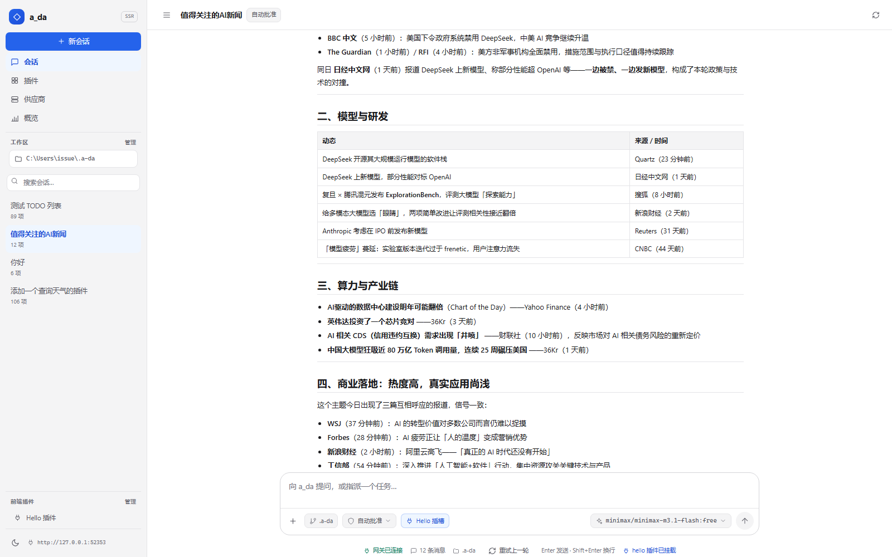
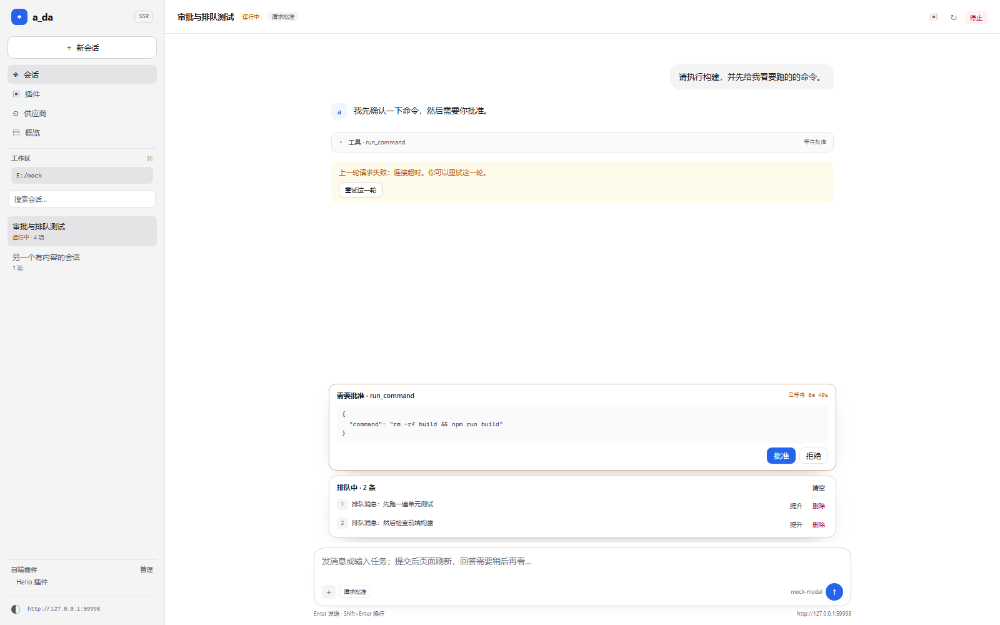

# a_da UED 设计文档（SSR-H 当前版）

| 项 | 值 |
|---|---|
| 文档版本 | v0.8 |
| 日期 | 2026-10-20 |
| 适用实现 | `crates/agent-web`（SSR Agent 界面，2026-10 起是唯一的界面） |
| 参考基线 | **本文自身**（原 `desktop-ui/` 已于 2026-10 移除；历史基线用 git 历史取回） |

> 🔴 **2026-10-27**：审批与安全机制已物理删除。本文中“审批档位 / 审批浮窗 /
> 批准拒绝”等段落属于历史设计；当前界面只有提问与排队托盘。
| 状态 | 当前实现 + 目标规范；表中标出差距 |

> 2026-10 说明：本文原是把 `desktop-ui`（Electron 桌面端）验证过的布局、密度、状态语义与
> 交互约束翻译成 SSR/HTMX 版本，**那时 desktop-ui 是 UED 的单一参考源**。
> 那份实现已整体删除，现在 **SSR 就是唯一界面**：文中“与 desktop-ui 对齐”的描述
> 读作“历史设计溯源”，实际行为以 `crates/agent-web` 的模板 / `static/` 与本文的
> “目标规范”为准。



*当前实现：1600×1000 视口，浅色主题；真实会话数据用于验收。*

**v0.4 视觉刷新（2026-10-20）**：字符符号图标全部替换为统一的 14–16px 线性 SVG；侧栏导航/工作区/会话项/顶栏药丸重建层级；运行状态点（呼吸动画，尊重 `prefers-reduced-motion`）；≤760px 侧栏改抽屉 + 顶栏汉堡；新增共享确认对话框（`<dialog>`）用于中止等操作；flash 横幅可手动关闭并按级别自动消失；发送按钮空内容禁用；细滚动条与 `100dvh` 外壳。下文各节状态已同步更新；`preview-p0.png` 为刷新前的早期视觉，结构未变。

**v0.8 任务规划（todo）面板（2026-10-20）**：对齐 desktop-ui 的 `TodoFloatingPanel`——任务清单不插在正文流里，而是悬浮在会话区右上角，**默认收起为胶囊药丸**（列表图标 + 「任务规划」+ `3/12` 进度 + 当前步骤），展开是 320px 卡片（头部进度 + 复制 Markdown 清单 + 备注 + 步骤清单）。计划状态按 **set 替换 / update 按 id 增量合并 / get 只读** 的动作推演（不是"倒序找最后一张卡片"），由 `ui/todo.rs` 的 7 个单元测试锁住；展开收起用 `<details>`，无 JS 也可用，JS 只记住用户偏好。工具行里展开 `todo` 工具时同样排版显示清单。

**v0.9 任务卡片改为插件（2026-10-23）**：卡片外观与交互从应用壳搬到 `plugins/task-plan/`，挂载点由清单决定：**`chat.corner`（会话区右上角，默认）**或 **`composer.above`（输入框上方）**，改一行即可切换；卡片随 SSE `parts` 的 `corner` 字段刷新，展开偏好仍记在 `a_da_todo_panel_collapsed`。

**v1.0 task-plan 前端化（2026-10-27）**：`afterTodoUpdate` 点位已移除，`plugins/task-plan` 改为纯前端插件，直接读核心 `props.data.todo`；不再有后端状态文件或 `plan` action。（2026-10-26 的后端方案已撤回。）

**v0.10 模型选择器（参考 DeepSeek，2026-10-23）**：输入框右下角的模型药丸从"跳转供应商页"改为**向上弹出的两段式菜单**——`模型`（按供应商分组的清单，当前项打勾）与 `推理等级`（Auto / Low / Medium / High），底部保留「管理供应商与模型」入口。药丸同时显示当前模型与等级；切换走真实动作（`provider.setActive` / `config.setEffort`），切换后回到当前会话并给出 flash。无 JS 可用，JS 只补"点外面 / Esc 关闭、同层只开一个分组"；live 轮询替换的是 `#composer-model` 标签内容，菜单开合不受影响。

**v0.6 组件库与插件插槽（2026-10-20）**：界面契约收拢为**服务端组件库**（`ui/` + `static/components.css` + `static/components.js`）——组件在 Rust 侧渲染，模板只摆放；`static/ssr.css` 被吸收删除，只保留一份页面级样式；图标收拢到 `icons.rs` 单一来源；焦点态全库统一（品牌描边 + 3px 光环 + 聚焦提示文案）；输入框下方新增辅助功能区（状态提示/上下文/真实快捷操作）；工具与思考行**去掉展开箭头**，整行可点，开合状态由左侧色条+底色+字色表达；插件新增 **slots 插槽**机制与 register→load→mount→render→unmount→destroy 生命周期，加载/渲染异常逐插件隔离并降级到默认实现，支持停用/启用与热插拔。架构详见 [COMPONENTS.md](COMPONENTS.md)。

**v0.5 对话流与输入框对齐 desktop-ui（2026-10-20）**：工具/思考由「带边框的折叠卡」改为 desktop-ui 的**单行日志式**——单行显示图标、中文标签、目标对象与耗时，详情收在左侧导轨线的浅底面板里（输入参数 / 执行输出各带复制）；思考行折叠时显示末行预览（斜体）。为此在数据层补齐：工具中文标签（对齐 `TOOL_LABEL`）、目标对象抽取（路径拆文件名+目录、`git` 按 action 翻译）、状态语义色、真实耗时（`durationMs`）、参数（`args`/`rawArgs`）、结果（`output`/`details`）。输入框改为桌面端形态：大圆角输入卡 + 底部工具行（左：附件/工作区/审批档位药丸；右：模型 + 近黑圆形发送键），审批档位按语义着色（完全访问=红）。Markdown 渲染补开 GFM（自动链接/删除线），工具输出按 Markdown 渲染、JSON 仍走等宽原文。

---

## 1. 设计结论摘要

`ssr-h` 当前已经具备一套可用的 Agent 主界面：

- 左侧会话栏 + 中间对话流 + 底部输入框的单窗口结构；
- 会话搜索、运行中状态、前端插件导航；
- Markdown 正文、思考/工具折叠、代码复制、Enter 发送；
- 插件/供应商/概览页与聊天页共用同一套侧栏；
- 深浅色主题、静态资源 no-store + 版本串。

`desktop-ui` 的高风险状态面已经补齐到 SSR 版：

| 项 | 当前状态 | 说明 |
|---|---|---|
| 审批操作面 | ✅ 已落地 | `waiting_approval` → live 托盘卡片（参数预览 / 等待时长 / 批准拒绝），出现与消失都不需要刷新 |
| 排队消息 | ✅ 已落地 | 当前会话的排队消息可见，可提升/删除/清空（提升会中断当前回答，已确认） |
| 失败重试 | ✅ 已落地 | `notice.level=error` 卡片带「重试这一轮」；动作失败回会话页 flash |
| 连接状态 | ✅ 已落地 | 聊天页与二级页（概览/扩展）都保留外壳 + 「未连接」+ 重新连接，不显示假统计 |
| 工具状态 | ✅ 已落地 | `waiting_approval` 等状态中文化 |
| 13px 正文 / 860px 阅读宽度 | ✅ 已落地 | 正文 13px，主区/Composer/浮层统一 860px |
| 上下文/变更/进程/命令面板 | ○ 待做 | P2 |
| 提问浮窗 | ✅ 已落地 | 输入框上方提问托盘（题目/选项/文本补充/提交回答），随事件流出现消失；`thread.tray` 插件可接管渲染 |

---

## 2. 参考基线与设计边界

### 2.1 历史事实基线（原 React 桌面端）

> 2026-10：`desktop-ui/` 已整体移除，下表**保留为设计溯源与数值基线**；
> “来源”列的链接会失效，需要核对时用 git 历史取回对应文件。

| 维度 | 事实 | 来源（已移除） |
|---|---|---|
| 窗口最小宽度 | `860px` | [layout.ts](../../desktop-ui/src/utils/layout.ts#L22-L28) |
| 侧边栏 | 默认 `270px`，范围 `180–560px`，可拖动 | [layout.ts](../../desktop-ui/src/utils/layout.ts#L55-L58) |
| 右侧栏 | 展开 `264px`，收起 `48px`；>1100px 并排，否则覆盖式 | [layout.ts](../../desktop-ui/src/utils/layout.ts#L30-L47) |
| 主区最小宽度 | `420px` | [layout.ts](../../desktop-ui/src/utils/layout.ts#L24-L27) |
| 对话最大阅读宽度 | `840px` | [layout.ts](../../desktop-ui/src/utils/layout.ts#L43-L53) |
| 标题栏高度 | `40px`（`h-10`） | [TitleBar.tsx](../../desktop-ui/src/components/TitleBar.tsx#L96-L103) |
| 主色 | `#3b82f6`，hover `#2563eb` | [tailwind.config.js](../../desktop-ui/tailwind.config.js#L10-L17) |
| 浅色背景/表面/描边 | `#ffffff` / `#f4f4f5` / `#e4e4e7` | [index.css](../../desktop-ui/src/index.css#L5-L24) |
| 深色背景/表面/描边 | `#18181b` / `#27272a` / `#3f3f46` | [index.css](../../desktop-ui/src/index.css#L12-L17) |
| 输入框 | `rounded-xl/2xl`，浅色 `border-zinc-300`，focus 蓝环 | [Composer.tsx](../../desktop-ui/src/components/Composer.tsx#L703-L710) |
| 审批 | 只允许在输入框上方的浮窗操作，不占布局 | [ApprovalFloatingPanel.tsx](../../desktop-ui/src/components/ApprovalFloatingPanel.tsx#L1-L16) |
| 模式 | 只在新建会话时选择；开始后只读 | [ModeSlider.tsx](../../desktop-ui/src/components/ModeSlider.tsx#L23-L37) |

### 2.2 ssr-h 的约束

- **SSR 优先**：页面由 Axum + Askama 输出；没有 React 状态树。
- **SSE 增量更新**：`GET /threads/{id}/stream` 订阅网关的 `evt.state.patch`，正文按 item 原位替换（约 25FPS 合帧），托盘/规划/顶栏/输入框走 `parts`；新增/删除卡片才整段同步。事件流断开时 `EventSource` 自动重连，期间由同一段脚本用 2 秒 `fetch` 轮询 `/threads/{id}/live` 兜底。发送消息后整页跳回。
- **无 Electron 能力**：没有原生窗口控制、拖拽区、多标签页；浏览器标签即窗口。
- **无客户端持久状态**：折叠、滚动、搜索等只能靠 `chat.js` 在页面内维护。
- **安全边界**：模型 Markdown 先 `pulldown-cmark` 再 `ammonia` 清洗；插件 HTML 按本地受信任内容处理。

---

## 3. 设计原则

1. **操作面唯一**：同一件事只留一个可操作入口（典型：审批只在浮窗，不在对话流卡片上重复按钮）。
2. **状态必须真实**：运行中、排队中、等待批准、待答复、失败、完成必须来自快照/回执，不能用“看起来像”代替。
3. **阅读优先**：长回答需要稳定阅读宽度、可读字号、代码块横向滚动，而不是把内容铺满窗口。
4. **布局稳定**：浮层出现/消失不顶动对话流与输入框；流式更新不改变卡片顺序。
5. **渐进披露**：思考、工具详情、长输出默认折叠；用户需要时再展开。
6. **可恢复**：草稿、滚动位置、折叠状态、搜索词在刷新/轮询后尽量保留。
7. **暗色等价**：浅色与深色是同一信息层级，不是两套不同的产品。
8. **失败安全**：拿不到状态就明确说“未确认/未连接”，不把空数据伪装成成功。

---

## 4. 信息架构

### 4.1 desktop-ui 结构

```text
┌────────────────────────────────────────────────────────────┐
│ TitleBar 40px：Logo / 工作区 / 模式 / 连接 / 设置 / 插件 / 窗口控制 │
├──────────────┬─────────────────────────────────────────────┤
│ Sidebar      │ TabStrip 会话多标签                          │
│ 270px        ├─────────────────────────────────────────────┤
│              │ Transcript                                  │
│ 新会话        │   用户消息 / 助手 Markdown / 思考 / 工具卡    │
│ 会话树        │   Notice / 审批记录 / Diff / 重试            │
│ 工作区        │                                             │
│              ├─────────────────────────────────────────────┤
│              │ Composer（审批/提问浮窗覆盖在它上方）          │
│              │   输入 / 模式 / 审批档位 / 思考力度 / 发送     │
│              ├─────────────────────────────────────────────┤
│              │ 遥测：轮次 / Token / 用时 / 上下文占用        │
└──────────────┴─────────────────────────────────────────────┘
```

### 4.2 ssr-h 结构

```text
┌──────────────┬─────────────────────────────────────────────┐
│ Sidebar 264  │ Topbar 54：会话标题 / 模式 / 运行中 / 刷新 / 停止 │
│              ├─────────────────────────────────────────────┤
│ a_da  SSR    │ Transcript（SSE 增量推送）                    │
│ 新会话        │   用户气泡 / 助手 Markdown / 思考折叠          │
│ 会话/插件/供应商│   工具折叠 / Notice / 空状态                 │
│ 工作区树      │                                             │
│ 搜索          ├─────────────────────────────────────────────┤
│ 会话（组内）  │ Composer                                     │
│ 前端插件      │   输入 / 审批档位 / 模型 / 发送               │
│              ├─────────────────────────────────────────────┤
│              │ Footer：快捷键提示 / 网关                    │
└──────────────┴─────────────────────────────────────────────┘
```

### 4.3 路由与页面职责

| 路由 | 页面 | 说明 |
|---|---|---|
| `/` | 对话主页 | 自动选择 `activeThreadId`，没有则第一条；侧栏列出会话 |
| `/threads/{id}` | 指定会话 | 同一套主界面，定位到指定 thread |
| `/threads/{id}/live` | 兜底片段 | OOB HTML；SSE 断开期间的 2 秒轮询 |
| `/threads/{id}/stream` | 事件流 | SSE：`transcript` / `item` / `parts` 三类事件 |
| `/threads/{id}/partial` | 对话片段 | 仅 transcript HTML（调试/手工刷新用） |
| `/workspaces` | 工作区选择/添加 | 目录浏览器（`fs.roots` / `fs.list`），选目录后打开或新建该工作区的会话 |
| `/workspaces/select` | 选择工作区 | `workspace.add` → 打开最近会话 / `thread.create` → 303 到会话页 |
| `/workspaces/mkdir` | 新建目录 | `fs.mkdir` → 进入新目录 |
| `/overview` | 概览 | 会话数、运行中、模型、前端插件数 |
| `/extensions` | 扩展 | 前端插件 + agent 插件；两套重载入口 |
| `/ext/provider-admin/providers` | 供应商 | 前端插件页；左列选供应商、右侧改连接参数与模型；密钥不回显 |\n| `/providers` | 旧入口 | 303 跳到插件页，保留动作端点的回退路径 |
| `/ext/{id}/{slug}` | 前端插件页 | 运行时 HTML 片段 + 静态资源 |
| `/ext/{id}/assets/*` | 插件资源 | 路径规范化 + 根目录越界拒绝 |

---

## 5. 布局与响应式

### 5.1 尺寸规范

| 项 | desktop-ui | ssr-h 当前 | 目标 |
|---|---|---|---|
| 侧栏宽度 | 270（180–560，可拖动） | 264；≤960 为 220；≤680 隐藏 | 264 固定；≤960 为 232；≤720 变抽屉/隐藏 |
| 主区最小宽度 | 420 | 未强制 | 在 CSS 中保证 420 |
| 阅读宽度 | 840 | 860 | 840–880 |
| 顶栏 | 40 + TabStrip | 54 | 54（SSR 合并标题栏与页签） |
| 输入框 | 底部固定，浮窗覆盖 | 底部固定 | 保持 |
| 侧栏内容密度 | 紧凑树节点，26px 行高 | 会话 2 行，约 44px | 保持两行：标题 + 计数/运行中 |
| 空状态宽度 | `max-w-2xl`（672） | 文本约 380px，容器随主区 | 容器 ≤560，文本 ≤480 |

### 5.2 响应式规则

- `> 1100px`：完整侧栏 + 主区；未来可恢复右侧上下文栏。
- `960–1100px`：侧栏缩到 236px；对话宽度自适应。
- `680–960px`：侧栏 236px；隐藏低优先级文本（插件数量、网关完整地址）。
- `< 760px`：侧栏收为**抽屉**（顶栏汉堡按钮唤出，遮罩/Esc 关闭），主区单列；输入框占满宽度。
- 所有高度用 `100dvh`（已在 CSS 中以 `100vh` 回退落地）。

### 5.3 滚动与固定区

- 页面本身不滚动；只有 transcript 滚动。
- Composer 固定在主区底部；不随消息流滚动。
- 审批/提问/排队浮层覆盖在 Composer 上方，**不占布局空间**。
- 侧栏会话列表独立滚动；搜索框固定在列表上方。

---

## 6. 视觉语言

### 6.1 色彩

#### desktop-ui 基准

| Token | Light | Dark | 用途 |
|---|---|---|---|
| background | `#ffffff` | `#18181b` | 页面/主区背景 |
| surface | `#f4f4f5` | `#27272a` | 侧栏、次级表面 |
| border | `#e4e4e7` | `#3f3f46` | 分割线、输入框 |
| primary | `#3b82f6` | 同左 | 主按钮、focus |
| primary-hover | `#2563eb` | 同左 | 主按钮 hover |
| text | `zinc-900 #18181b` | `zinc-100 #f4f4f5` | 正文 |
| muted | `zinc-500 #71717a` | `zinc-400 #a1a1aa` | 次级信息 |
| faint | `zinc-400 #a1a1aa` | `zinc-500 #71717a` | 辅助/占位 |
| PM | `amber-500` | `amber-400` | PM 模式 |
| Plan | `purple-500` | `purple-400` | 规划模式 |
| Create | `emerald-500` | `emerald-400` | 创造模式 |
| Danger | `rose-600/red-600` | `rose-400` | 停止、失败、删除 |

#### ssr-h 当前 Token（Black Swan 主题，2026-10-24）

`ssr-h` 复用 `plugin-hub` 的 `--ph-*` 设计变量，和 desktop-ui 的 zinc 体系“同调但不同名”，迁移时按语义映射，不要按色值硬拷贝。
主调取自 LOGO：宣纸暖白 `#F6F3EC` + 墨黑 `#16171A`（详见 [design/COLOR-SYSTEM.md](../../design/COLOR-SYSTEM.md)）。

| Token | Light | Dark | 语义 |
|---|---|---|---|
| `--ph-canvas` | `#f6f3ec` | `#121110` | 页面画布（LOGO 底色） |
| `--ph-surface` | `#fcfaf5` | `#1a1917` | 主区/卡片 |
| `--ph-elevated` | `#ffffff` | `#22201d` | 浮层/菜单 |
| `--ph-line` | `#e6e0d4` | `#2e2b27` | 普通分割线 |
| `--ph-line-strong` | `#d5ccbc` | `#433f38` | 输入框/强调边框 |
| `--ph-ink` | `#16171a` | `#f3efe6` | 主文字（LOGO 墨色） |
| `--ph-muted` | `#54524c` | `#b9b2a5` | 次级文字 |
| `--ph-faint` | `#6e6a60` | `#928b7e` | 辅助文字 |
| `--ph-brand` | `#16171a` | `#f3efe6` | 主色（墨；暗色反转为纸白） |
| `--ph-brand-strong` | `#000000` | `#ffffff` | hover/按下 |
| `--ph-brand-soft` | `#ece5d8` | `rgba(243,239,230,.12)` | 品牌浅底（暖沙） |
| `--ph-brand-ink` | `#16171a` | `#f0e7d6` | 品牌文字 |
| `--ph-on-brand` | `#f6f3ec` | `#16171a` | 品牌底上的文字/图标 |
| `--ph-subtle` | `#f0ebe1` | `#201e1b` | 侧栏/浅底 |
| `--ph-success-soft` | `#e7f0e7` | `#1b2a22` | 成功浅底 |
| `--ph-success-ink` | `#2f6b4a` | `#8fd3b0` | 成功文字 |
| `--ph-warn-soft` | `#f8eedc` | `#2c2418` | 警告浅底 |
| `--ph-warn-ink` | `#8a5a12` | `#e8c583` | 警告文字 |
| `--ph-danger-soft` | `#f8e7e4` | `#2e1d1b` | 危险浅底 |
| `--ph-danger-ink` | `#a3342b` | `#f0a59c` | 危险文字 |
| `--ph-code-bg` | `#17181b` | `#0e0d0c` | 代码块（LOGO 墨色） |
| `--ph-code-ink` | `#ede8dd` | `#ede8dd` | 代码文字 |

**规范**：

- 品牌色只用于“主操作、focus、当前选中”，不要大面积铺底；单色品牌下链接必须带下划线。
- **品牌底上的文字一律用 `--ph-on-brand`**，不许写死 `#fff`（暗色主按钮是米白底）。
- 状态色必须成对使用“浅底 + 深字”；不要只换文字色导致暗色对比不足。
- 失败/停止使用 danger；等待批准使用 warn；运行中使用 brand 或 warn（当前顶栏用 warn，对话工具用中性）。
- 正文对比度不低于 WCAG AA（普通文字 4.5:1）；当前色板最低组合为 4.87:1。

### 6.2 字体与排版

|层级|desktop-ui|ssr-h 当前|目标|
|---|---|---|---|
|界面字体|系统无衬线|同左|`-apple-system, BlinkMacSystemFont, "Segoe UI", Roboto, "Helvetica Neue", Arial, "Microsoft YaHei", sans-serif`|
|等宽|Cascadia Code / JetBrains Mono / Consolas|同左|同左；用于工具名、路径、代码、Token|
|正文|13px / 1.6–1.7|12px / 1.75|13px / 1.7|
|会话标题|13–14px / 600|12px / 500|13px / 600|
|辅助|10–11px|9–10px|10–11px；关键说明不低于 10px|
|页面标题|20–24px|20px|20px / 600|
|代码|11–12px|11px|11–12px / 1.6|

规则：

- 中文正文不用全大写、不用过宽 letter-spacing；仅英文标签/分组标题使用 `uppercase tracking-wider`。
- 阅读宽度 840–880px；超过后行宽过长，眼睛回扫成本高。
- 段落间距 `.65–.8em`；标题上下留白大于正文间距。
- 长 URL、路径、工具参数允许 `break-all` 或横向滚动，不撑破容器。
- 工具名、模型名、会话 id 使用等宽字体，便于扫读和复制。
- 助手正文、用户消息都可以复制；界面 chrome（按钮、分组标签）默认 `select-none`。

### 6.3 间距、圆角、阴影

|项|规范|
|---|---|
|间距基数|2 / 4 / 6 / 8 / 10 / 12 / 14 / 16 / 20 / 24 / 28 / 32|
|侧栏内边距|12px；会话项 7–8px 垂直|
|主区内容内边距|24–28px（窄屏 16–18px）|
|卡片圆角|12–16px；工具/思考折叠 10px|
|按钮圆角|6–8px；主按钮 8px；小药丸 6px|
|输入框圆角|16px（大输入框可 18px）|
|头像/品牌 mark|8–12px|
|阴影|默认极轻；`0 1px 2px rgba(24,24,27,.04), 0 12px 32px -24px rgba(24,24,27,.18)`；暗色不加大阴影|
|边框|1px；用 `line` 分区，用 `line-strong` 标输入框/可交互边界|

### 6.4 图标与插画

- desktop-ui 使用 lucide 线性图标，尺寸 11–16px；按钮内图标与文字间距 4–6px。
- `ssr-h` 已落地统一的 14–16px 线性 SVG 图标集（stroke 1.75、圆角线帽、`currentColor`）：新会话、会话/插件/供应商/概览导航、工作区、搜索、主题日月、刷新、停止、发送、时钟、批准/拒绝、删除、提升、折叠箭头、思考、工具、告警、机器人头像、审批盾牌、插件插头、外链、菜单。v0.4 起不再使用字符符号。
- **品牌 mark 使用产品 LOGO**（`assets/logo.png`，黑天鹅 + 暖米白底）：侧栏品牌位 / 窄轨 / 空状态 /
  站点 favicon 统一走 `/static/logo.png`（ssr-h 编译期内嵌；desktop-ui 用 `LOGO_URL`，Electron 窗口与
  exe 图标沿用 `assets/logo.ico`）。不加装饰性大插画，保持工具型产品气质。

### 6.5 动效

- 颜色/边框过渡 120–150ms；面板出现 150–200ms。
- 不使用大幅位移、弹跳、缩放；仅浮层可轻微 `translateY(4px) → 0`。
- 流式内容不做逐字动画；工具状态用颜色与文字变化。
- 尊重 `prefers-reduced-motion: reduce`：关闭过渡和自动滚动动画。

---

## 7. 组件规范

### 7.1 应用外壳

**desktop-ui**：`TitleBar` + `Sidebar` + `TabStrip` + `Transcript` + `Composer`，主区 `flex-1 flex flex-col overflow-hidden`。

**ssr-h**：`chat-shell` = `chat-sidebar` + `chat-main`；`chat-main` = `chat-topbar` + `chat-scroll` + `chat-composer`。

规范：

- 页面高度固定为视口，外层不滚动；只允许 transcript / 侧栏列表 / 二级内容滚动。
- 侧栏与主区之间 1px `line`；不要用厚阴影制造“悬浮卡片”。
- 主区最大阅读宽度居中；超出部分留白，不把内容贴到窗口边缘。
- 当前会话高亮用 `subtle` 背景 + `ink` 文字；不要只靠左侧色条。

### 7.2 侧栏

结构（从上到下）：

1. 品牌（`a_da` + 产品徽标）
2. 新会话（提交到当前会话所属工作区）
3. 主导航（会话 / 插件 / 供应商 / 概览）
4. 当前工作区药丸（点击进入 `/workspaces` 添加/切换）
5. 工作区搜索
6. **工作区树**：工作区分组（目录名 + 会话数 + 运行中 + "当前"）→ 组内会话
7. 前端插件导航（可选）
8. 主题 + 网关

规则：

- 会话项展示「标题 + 元信息（运行中/条目数）」；标题单行省略，`title` 保留完整标题。
- 工作区按 `workspace` 分组（路径键大小写/斜杠归一）；**当前工作区即使没有会话也显示**，并默认展开。
- 空占位会话：有真实会话的工作区不显示占位；整个工作区都为空时保留最新一条，避免"刚添加的工作区"消失。
- 组头操作：`+` 在该工作区新建会话；非当前组提供 ✓ 切换（有空会话就打开最近一条，没有则新建）。
- 运行中使用 warn 文本或状态点，不使用闪烁动画。
- 搜索为纯前端过滤（工作区名 + 会话标题）；工作区名命中时整组展开、会话全显示；不改变当前会话，不触发请求。
- 侧栏宽度可固定；desktop-ui 的拖动改宽是 P2，SSR 版先不做。
- 子智能体树（desktop-ui 有）在 ssr-h 暂不实现；若后续实现，缩进 12–16px，父节点可折叠。
- **不做移除工作区**：后端会连同会话文件删除，Web 端不提供这个破坏性入口。

### 7.3 顶栏

desktop-ui 顶栏承载：产品/工作区/模式/连接/设置/插件/进程/变更/窗口控制。
ssr-h 顶栏收敛为：

- 左：会话标题 + 模式/审批档位 + 运行中徽标
- 右：返回/刷新/停止（运行中）
- 不再放窗口控制（浏览器负责）

规范：

- 标题超长省略，不换行；`title` 给完整标题。
- 模式与审批档位用 9–10px 药丸，不抢标题。
- 停止按钮只在运行中出现，使用 danger 软底，不放二次确认（中止是低风险、可重发）。
- 刷新按钮必须真的重取当前会话；不允许“点了但没变化”的假按钮。

### 7.4 对话流

#### 用户消息

- 右对齐，最大宽度约 680px；浅底、16px 圆角，右下角可小圆角。
- 保留换行；长文本 `overflow-wrap: anywhere`。
- 不使用头像（避免与助手混淆）；用户身份由位置与底色表达。

#### 助手消息

- 左对齐，26px 头像 + 正文；头像用品牌浅底。
- 正文 13px，Markdown 渲染；标题、列表、表格、代码块使用统一 `.markdown-body` 规则。
- 代码块：深色 `code-bg`，横向滚动，右上角复制按钮；复制成功 1.2s 内显示“已复制”。
- 不在助手正文里塞错误信息；错误走 Notice 卡片。
- 流式更新时保持滚动位置：只有用户接近底部才自动跟随。
- 离开底部时，对话区底部中央出现「回到最新」胶囊（核心 UI，不依赖插件插槽）；点击回到底部并恢复自动跟随。它与右下角 `composer.above` 插件悬浮卡分开，互不遮挡。

#### 思考 / 工具 / Notice

v0.5 起对齐 desktop-ui 的**单行日志式**表达：折叠态只占一行说清「做了什么 / 在想什么」，详情收在左侧导轨线里。

|类型|默认|单行内容|展开内容|状态徽标|
|---|---|---|---|---|
|思考|折叠|箭头 + 脑图标 + 「思考」+ 时长 + 末行预览（斜体）|导轨线 → 浅底面板「推理分析」+ 复制|无|
|工具|折叠|箭头 + 工具图标 + 中文标签 + 目标对象 + **结果尾标** + 耗时|导轨线 → 「执行输出」→「输入参数」|`等待批准 / 待答复 / 执行中 / 失败`|
|Notice|展开|失败/重试/系统提示|—|warn/danger 语义|
|压缩|展开|箭头 + 图标 + 「上下文压缩」|面板摘要|中性|
|Diff/变更|折叠/卡片|文件路径、增删行|P2|

规则：

- 单行高度 28px、正文 12px（v0.9 前是 24px / 11px；9.5px 的耗时在 Windows 125% 缩放下已接近不可读）；箭头在左、状态在右，工具图标随工具名切换。
- 工具标签用中文（对齐 desktop-ui `TOOL_LABEL`），未登记的工具回退显示原始 id。
- 目标对象是**「它在动什么」**：路径类工具拆成「文件名 + 目录」（目录更淡），`git` 按 action 翻译成人话，其余取参数主字段。
- 完成态不给徽标——默认就是「完成」，到处挂绿标反而吵；只有等待/执行中/失败才着色。
- **结果尾标**（v0.9）回答「它得到了什么」，紧跟目标之后、等宽弱色，只有异常与增删数着色：`167 行`、`128 通过 · 0 失败`、`+18 -4`、`exit 0`、`3/12`。取自工具自己的 `output` / `patch` / `details`，拿不到就留空——不估算、不编「完成」。
- 语义阶段用**左侧 2px 色条**表达：执行中=品牌色 + 1.6s 呼吸，等待批准=琥珀，失败=危险色 + 极浅危险底；行内文字不跟着变色。
- 执行中的耗时是**活的**：服务端给 `startedAt` 起点（`已 3s`），客户端每秒接着走；起点与本地时钟差超过一天就保持服务端文案（防时钟漂移写出天文数字）。
- 展开后**输出在前、参数在后**：点开一张卡是为了看结果，参数是补证据时才翻的。
- 长输出**只有一层折叠**：10 行预览 + 底部渐隐 + 「展开全部 42 行」，展开后最大 420px 内部滚动。不再是「工具行 + 嵌套 details」两层——那要用户点两次才看到全文。
- JSON 输出走等宽原文，其余按 Markdown 渲染（列表有排版、链接可点）；diff / 测试汇总 / 搜索命中的分型渲染见 P1。
- 审批记录卡只做“记录与预览”，操作必须在审批浮窗（desktop-ui 的硬约束）。

### 7.5 输入框 Composer

v0.5 起对齐桌面端输入框：大圆角输入卡 + 底部工具行（左右分组的药丸）。

```text
┌────────────────────────────────────────────────────────────┐
│ textarea（自动增高，max 180px）                             │
│ ────────────────────────────────────────────────────────── │
│ ＋  ⑂ 工作区  🛡 审批档位 ⌄        ✦ 模型名 ⌄        ( ↑ ) │
└────────────────────────────────────────────────────────────┘
（快捷键 Enter 发送 / Shift+Enter 换行 保留，但不再显示常驻提示行）
```

规范：

- 输入框是页面唯一主操作面；底部固定，不随 transcript 滚动。
- 输入卡圆角 18px，1px 描边；Focus 态：品牌色边框 + 3px focus ring，不使用发光/阴影堆叠。
- 底部工具行与输入区之间一条细分隔线；左右两组各自贴边。
- 发送按钮是全页最重的主操作：近黑圆形按钮（浅色主题黑底白箭头、深色主题白底深箭头），空内容时降级为浅灰禁用态。
- 审批档位药丸按语义着色：完全访问=红、每次询问=琥珀、自动批准=中性；当前只读展示，切换在桌面端设置里做。
- **图片输入**：输入卡上方预览已选图片（64px 缩略图 + 逐张移除）；支持「添加图片」按钮、粘贴、拖入输入卡；
  PNG / JPEG / WebP / GIF，单张 ≤8 MB、最多 4 张；有图时允许不写文字（纯图片消息）。
- **图片查看**：点击对话流/预览里的图片在当前页面浮层查看（固定大画布 + contain，Esc / 点遮罩 / 关闭按钮关闭），
  不跳新标签；无 JS 时保留 `<a href="data:…">` 作为兜底。
- **运行状态**：输入框左上方、与 `composer.above` 插件同一带，一个旋转弧 + 「运行中」；
  只表达"还在动"（顶栏已有文字状态，不重复信息），空闲时不占位，尊重 `prefers-reduced-motion`。
- 工具行里只放**真实可用**的控件；通用附件/语音等尚未落地的能力不放假的可点按钮。
- 运行中允许继续输入（后端排队）；排队列表在 Composer 上方托盘里。
- 发送中按钮禁用，避免重复提交。
- 子智能体会话（desktop-ui 有）不允许手动输入，显示只读说明；ssr-h 暂不支持。

### 7.6 审批 / 提问 / 排队浮层

这是 desktop-ui 最重要的 UED 约束。**SSR-H 已落地审批与排队托盘**（不是绝对覆盖层）：

| 项 | 位置 | 规则 |
|---|---|---|
| 审批 | Composer 上方的 in-flow 托盘 | 显示工具名、等待时长、待批准原文；批准/拒绝只在这里 |
| 排队 | Composer 上方的 in-flow 托盘 | 显示当前会话排队消息，可提升/删除/清空 |
| 提问 | Composer 上方的 in-flow 托盘 | ✅ 已落地：题目 + 选项（radio/checkbox）/ 文本补充 + 提交回答；**多题一次一题翻页**（`data-question-pager` 契约，页码跨刷新记忆，无 JS 平铺）；无选项题有「继续」兜底；对话流里的 ask_user 卡只留记录 |
| Todo/上下文/变更 | 右侧或浮层 | P2 |

- SSR 版**审批/排队用 in-flow 托盘**：输入框会随 textarea 增高，绝对定位容易压住发送按钮。
  托盘位于 transcript 与 composer 之间，不覆盖输入框；代价是审批/排队出现时会占用一部分 transcript 高度。
- **提问卡是例外（2026-10-24 用户拍板）：浮动覆盖**，不占布局空间——`position: absolute`
  锚在托盘区顶部（`bottom: 100%`），向上浮在对话流之上，与 desktop-ui 提问浮窗同形态；
  卡片自带高度上限与滚动，容器不再自裁剪（否则浮出的卡片会被 `overflow` 裁掉）。
- 审批没有内容预览就不允许批准；必须显示参数/命令/路径。
- 等待时长给用户“系统还在等”的真实感；超时按安全方向拒绝。
- 同一 callId 只允许一个操作面；对话流里的工具卡只做记录，操作走托盘。



*P0 验收：等待批准 + 参数预览 + 排队消息 + 失败重试，均在同一屏可见。*

### 7.7 空状态

- 新会话：品牌 mark + 标题 + 一句 persona + 模式选择 + 工作区 + 居中输入框（desktop-ui）。
- ssr-h 当前：品牌 mark + “开始一段新的对话” + 新建按钮；工作区在侧栏树与 `/workspaces` 里添加/切换。
- 空状态必须在窄窗口可滚动，不能用负位移把顶部裁掉。
- 不显示假的统计、假的会话、假的“已连接”。

### 7.8 通知与确认

- Toast：右下角堆叠，最多 5 条；error 6s，其它 3.5s；可带一个动作按钮（desktop-ui）。
- ssr-h 当前：页面内 `flash` 横幅，error 9s / 其它 6s 自动消失，可手动关闭；无动作按钮；适合 SSR 首屏，不适合高频操作。
- Confirm：共享确认弹窗是**组件库的纯 DOM 组件**（`ui::ConfirmDialog`，不用原生 `<dialog>`、
  更不用 `window.confirm`）：遮罩 + 卡片 + 右上焦点圈 + Esc 取消 + 打开时锁页面滚动；`form[data-confirm]`
  是唯一入口，当前用于「中止当前轮次」「删除供应商/模型」。

### 7.9 扩展 / 供应商 / 概览页

- 与聊天页共用左侧栏，顶部只保留页面标题与必要动作。
- 内容最大宽度 1040px；表格横向滚动，不压缩列。
- 插件卡：id、名称、版本、描述、导航/页面/资源徽标、打开入口。
- Agent 插件表：名称、scope、启用状态、工具数；错误信息用 danger 文本。
- **供应商页是 Master-Detail（对齐 desktop-ui）**：左列供应商清单（当前项带徽标、显示模型数，
  **行右端操作列放删除按钮**，只剩一个供应商时禁用），右列按**两个页签**组织：
  「供应商信息」放连接参数，「模型列表」放 **表格式模型列表**
  （ID / 显示名 / 上下文 / 最大输出 / 图片 / 状态 / 操作）。
  页签导航条是真实链接（`?tab=`，无 JS 也能切换），有 JS 时就地切换并改写地址栏；
  保存供应商停在「供应商信息」，模型增删改后回到「模型列表」——不会因为刷新把人甩回默认页签。
  **编辑与新增模型都在弹窗里做**（`Modal` 组件）：列表只展示、不内联编辑，避免一行里塞四个输入框；
  弹窗放在页签容器之外，切页签时不会跟着 `hidden` 一起消失。
  能力与桌面端一致：新建 / 编辑 / 删除 / 设为当前 / 测试连接 / 获取远程模型 / 增删改模型。
- **API Key 不回显**：只显示 `已配置 + sk-…7f3a`，输入框留空＝不修改，勾“清空密钥”才真的清空。
  这是与 desktop-ui 唯一的有意差异（桌面端把整串密钥灌进密码框）。
- 仍然成立的一条：**不要让控件看起来可编辑却提交不了**——本页所有控件都有对应 POST 路由。

---

## 8. 交互与状态模型

### 8.1 会话生命周期

```text
新建 → 空闲 → 发送 → 运行中 → 完成
                     ├→ 等待批准 → 批准/拒绝 → 运行中
                     ├→ 待答复 → 回答 → 运行中
                     ├→ 排队中（运行中继续发送）
                     └→ 失败 → Notice + 重试
```

状态呈现：

|状态|侧栏|顶栏|对话流|Composer|
|---|---|---|---|---|
|空闲|普通|无徽标|历史|可发送|
|运行中|`运行中`|warn 徽标|流式/轮询更新|可输入，显示“将排队”|
|等待批准|warn|warn|记录卡|审批浮窗|
|待答复|brand|brand|问题卡|提问浮窗|
|失败|danger 点|danger|Notice + 重试|可重新发送|

### 8.2 发送与排队

- Enter 发送、Shift+Enter 换行；IME 组合输入中不发送。
- 发送后整页跳回该会话（SSR 表单语义）；随后由 SSE 增量推送正文，不再是每 2 秒一大段。
- 运行中继续发送：后端会排队；UI 必须显示排队结果，不能静默吞掉。
- 排队项支持提升/删除/清空（desktop-ui）；ssr-h P0 至少显示“已排队 N 条”。

### 8.3 刷新与实时性

- ssr-h 通过 `GET /threads/{id}/stream`（SSE）接收增量：正文按 item 原位替换（约 25FPS 合帧），新增/删除卡片整段同步；托盘/规划/顶栏/输入框为 `parts`（≥500ms）。仅在接近底部时自动滚动。
- 事件流断开时 `EventSource` 自动重连，期间由同一段脚本用 2 秒 `fetch` 轮询 `/live` 兜底；重连成功后自动停掉兜底，界面自愈（重连先整段同步一次）。
- 增量替换后恢复折叠状态（`data-key`）与面板滚动位置；代码复制按钮重新挂载。
- 与 desktop-ui 同源：两边都消费 `evt.state.patch`，只是传输从 WS 换成了 SSE。

### 8.4 主题

- `html.dark`/`html.light` class；`localStorage.a_da_theme` 优先，否则跟随系统。
- 禁止只在浅色下检查对比度；暗色必须逐组件验收。
- 主题切换按钮放在侧栏底部，图标为月亮/太阳或半圆。

### 8.5 键盘与焦点

|操作|快捷键|
|---|---|
|发送|Enter|
|换行|Shift+Enter|
|关闭浮层/取消|Escape|
|侧栏会话搜索|Ctrl/Cmd+K（**ssr-h 当前占用**，见下）|
|命令面板|Ctrl/Cmd+K（desktop-ui；ssr-h P2）|
|侧栏搜索（命令面板落地后）|`/` 聚焦搜索框|
|审批确认|Enter（desktop-ui Confirm）|

- **Ctrl/⌘+K 的归属要显式拍板**（2026-10-24 记）：ssr-h 现在把它绑在「展开侧栏并聚焦会话搜索」
  （`static/chat.js`）。命令面板（P2）上线时接管 Ctrl+K，侧栏搜索改用 `/`——不要留成双绑，
  否则同一个键在两种语境下做两件事。
- 所有可点击元素有 `:focus-visible` 外环；不要只靠 hover。
- 浮层打开后焦点进入浮层；关闭后回到触发元素。
- 输入框 `autofocus` 仅在新建/空会话，不要抢滚动阅读的焦点。

---

## 9. 文案与状态词

- 统一中文：`新会话`、`会话`、`插件`、`供应商`、`概览`、`运行中`、`等待批准`、`待答复`、`排队中`、`完成`、`失败`、`已停止`。
- 工具名保留英文 id（`ask_user`、`run_command`），旁边用中文标签解释。
- 错误文案必须说明“发生了什么 + 下一步”：
  - 好：`读取会话失败：网关连接超时。请确认桌面端仍在运行。`
  - 差：`Error` / `失败` / `undefined`。
- 不把技术错误直接塞进助手正文；用 Notice。
- 不用“已完成”描述未确认的状态；未接线就写“未确认/未连接”。

---

## 10. 可访问性

- 正文对比度 ≥ 4.5:1；大字/图标 ≥ 3:1。
- 可点击区域 ≥ 28×28px；图标按钮必须有 `aria-label`/`title`。
- 侧栏会话项是链接/按钮，不用纯 `div` 点击。
- 折叠使用原生 `<details>/<summary>`；保留键盘展开能力。
- 图片/插件内容有替代文本；插件页标题说明来源。
- 尊重 `prefers-reduced-motion`；关闭平滑滚动与过渡。
- 颜色不是唯一状态信号：运行中同时有文字，失败同时有图标/文案。

---

## 11. ssr-h 当前实现映射与差距

图例：✅ 已实现　◐ 部分实现　○ 未实现

| desktop-ui 能力 | ssr-h 对应 | 状态 | 说明 |
|---|---|---|---|
| TitleBar（窗口控制/拖拽） | `chat-topbar` | ◐ | 无窗口控制；浏览器标签替代 |
| 侧栏（树/拖动/悬停操作） | `chat-sidebar` + 工作区树 | ◐ | 有工作区树 + 会话行内重命名/删除（`thread.update`/`thread.delete`）；无子智能体树、无拖动改宽 |
| 会话列表实时性 | `#thread-list` 随 parts/OOB 换新 | ✅ | 其它客户端的增删/改名/运行点随事件流进来；切换器与系统导航仍是整页快照 |
| 工作区树 / 添加 / 切换 | 侧栏树 + `/workspaces` | ✅ | 按 workspace 分组；组内新建；目录浏览器选择目录后打开/新建会话 |
| 会话搜索 | `chat-thread-search` | ✅ | 纯前端过滤工作区名与会话标题 |
| TabStrip 多标签 | 无 | ○ | 浏览器标签替代；P2 |
| Transcript Markdown | `partials/transcript.html` | ✅ | `pulldown-cmark` + `ammonia` |
| 流式更新 | SSE 订阅 `evt.state.patch` | ✅ | 正文按 item 增量替换（约 25FPS）；结构变化整段同步；断流退回 2s 轮询 |
| 思考/工具折叠 | `<details>` 单行 + 导轨线 | ✅ | v0.5 对齐 desktop-ui；按 item id 在 live 替换后保持展开 |
| 代码复制 | `chat.js` | ✅ | 悬停显示复制按钮 |
| 工具状态文案 | `tool_status_label` | ✅ | waiting_approval → 等待批准等 |
| 工具中文标签/目标对象 | `tool_label` / `tool_target` | ✅ | v0.5：中文标签 + 文件名/目录 + git 动作翻译 |
| 工具真实耗时 | `durationMs` | ✅ | v0.5：毫秒值，不用编造时长 |
| 审批浮窗 | in-flow 审批托盘 | ✅ | 参数预览 + 等待时长 + 批准/拒绝；live 更新 |
| 提问浮窗 | in-flow 提问托盘（核心实现 + `thread.tray` 插件可接管） | ✅ | 归一化投影 `data.questions`；作答走 `POST /questions/{call_id}/answer` → `question.answer` |
| 排队列表 | in-flow 排队托盘 | ✅ | 可见、提升（中断并确认）、删除、清空 |
| 失败 Notice + 重试 | Notice + 重试按钮 | ✅ | 仅 `level=error` 显示；按钮是真表单 |
| 连接状态 | 离线壳 + 重新连接 | ✅ | 二级页同样保壳（2026-10-24）；供应商/插件页数据取不到时走各自的降级提示 |
| 图标系统 | 内联线性 SVG 集 | ✅ | v0.4：14–16px，替代字符符号 |
| 移动端抽屉侧栏 | 汉堡 + 遮罩 + Esc | ✅ | ≤760px |
| Confirm 对话框 | 共享 `<dialog>` | ✅ | 中止已接入；删除/重载可接 |
| 任务规划面板 | 悬浮药丸/卡片（插件） | ✅ | v1.0 起由 `plugins/task-plan/` 统一插件渲染；2026-10-27 起只读核心 `props.data.todo` |
| Composer 主交互 | `chat-composer` | ◐ | v0.5 对齐桌面端输入框；v0.10 起模型/推理等级可切换；2026-10-24 起支持图片输入（选图/粘贴/拖入、预览移除）；仍无通用附件/@/斜杠 |
| 模式滑块 | 空会话页四档分段 | ✅ | 2026-10-24：编码/规划/创造/PM 就在空会话页里选（`POST /threads/{id}/mode` → `thread.setMode`），开始后不可切（与 desktop-ui 的 EmptyConversationView 一致）；新建弹窗已移除 |
| 工作区选择（新会话） | 空会话页药丸下拉 + 「选择工作区」弹窗 | ✅ | 2026-10-24：药丸列出已有工作区（当前项打勾）；「选择工作区」打开目录选择弹窗（对齐 desktop-ui WorkspaceSelector：盘符/常用位置、路径、进入子目录、新建文件夹、选定此工作区），选定只改会话属性、不换当前项目；无 JS 回退整页 `/workspaces?bind=` |
| 审批档位 | 可点药丸 → 四档弹层 | ✅ | 2026-10-24：输入框工具行的药丸点开即切换（`config.setApproval`，后端落盘广播）；当前项打勾禁用、完全访问带确认；未连接时保持只读 |
| 右键栏/上下文面板 | 无 | ○ | P2 |
| 变更/Diff 面板 | 无 | ○ | P2 |
| 进程/后台任务面板 | 无 | ○ | P2 |
| 命令面板 | 无 | ○ | P2 |
| Toast | flash 横幅 | ◐ | 无自动消失/动作 |
| Confirm 对话框 | 无 | ○ | 中止/删除等需要 |
| 插件市场/发布 | 无 | ○ | 当前只有扩展列表与重载 |
| 前端插件运行时 | `plugins/` | ✅ | 导航/卡片/页面/资源 |

---

## 12. 迭代建议

### P0（已完成，2026-10-20）

1. ✅ **审批托盘**：参数预览 + 等待时长 + 批准/拒绝；SSR 采用 in-flow 托盘。
2. ✅ **排队可见**：当前会话排队消息可查看、提升、删除、清空。
3. ✅ **失败 Notice + 重试**：`notice.level=error` 直接带「重试这一轮」。
4. ✅ **连接状态**：网关断开时保留壳并显示「未连接」+ 重新连接。
5. ✅ **工具状态中文化**：`waiting_approval` → 等待批准，`done` → 完成等。

### P1（阅读与主流程）

1. ✅ 正文字号 13px，阅读宽度 860px。
2. ✅ 工具状态中文化：`执行中 / 等待批准 / 待答复 / 完成 / 失败`，英文 id 保留在 `title`/mono。
3. ◐ 模型可切换（v0.10 模型选择器）；审批档位仍只读（需打开桌面端设置）。
4. ✅ 发送中按钮 loading + 防重复提交；v0.4 增加空内容禁用。
5. ✅ 共享 Confirm 对话框（v0.4）：中止已接入；删除/重载覆盖待接。
6. ◐ Toast 替代高频 flash；SSR 页面保留 flash 作为首屏反馈（v0.4 起可关闭、自动消失）。

### P2（能力面）

1. TabStrip/多会话标签。
2. 右侧上下文/变更/进程面板。
3. 命令面板、斜杠指令、@ 提及、附件。
4. 插件市场/发布接入 `plugin-hub`。
5. 侧栏拖动改宽、子智能体树。
6. 提问浮窗（`question.answer`）。

---

## 13. 验收清单

### 视觉

- [ ] 1280/1440/860 宽度下无横向溢出；侧栏不压扁主区。
- [ ] Light/Dark 两套主题下文字、边框、状态色对比度达标。
- [ ] 图标统一为线性 SVG，按钮内图标与文字间距 4–6px。
- [ ] 正文行长不超过约 60 个汉字；代码块横向滚动。
- [ ] 工具/思考折叠标题左对齐，状态靠右，不出现居中/挤压。
- [ ] 输入框在底部固定，长对话滚动时不离开视口。
- [ ] 浮层出现/消失不顶动 Composer 与 transcript。
- [ ] ≤760px 侧栏为抽屉：汉堡唤出、遮罩/Esc 可关。

### 交互

- [ ] Enter 发送、Shift+Enter 换行、IME 不误发。
- [ ] 增量/整段同步后折叠状态保持；代码复制按钮可用。
- [ ] 助手正文按增量长出来（同一秒内多次变化），不是每 2 秒跳一大段。
- [ ] 侧栏树按工作区分组；选中新目录后该工作区出现并成为"当前"；选已有工作区打开最近会话而不是重复建。
- [ ] 向上阅读时不被自动滚动拉回底部。
- [ ] 向上阅读时出现「回到最新」，点击回到底部并重新跟随；插件悬浮区不被遮挡。
- [ ] 搜索会话不改变当前会话，清空后恢复全部。
- [ ] 运行中发送有明确“排队/已接收”反馈。
- [ ] 审批浮层可见参数、等待时长，批准/拒绝只出现一处。
- [ ] 失败有 Notice 与重试入口。
- [ ] 空会话/空列表/网关离线都有明确空状态。

### 技术

- [ ] 静态资源 `no-store`，改版带版本串，避免旧 CSS。
- [ ] Markdown 经过白名单清洗，`<script>` 不执行。
- [ ] 插件资源路径做 canonicalize + 根目录校验。
- [ ] 页面在禁用 JS 时仍能读出主要内容（SSR 基线）。
- [ ] 无真实数据时不显示假统计/假连接状态。

---

## 14. 参考文件

**SSR 界面（唯一实现）**

- [shell.css](../static/shell.css)
- [components.css](../static/components.css)
- [chat.js](../static/chat.js)
- `ui/` 模板与组件（相对 `crates/agent-web`）：`ui/sidebar.rs`、`ui/components/messages.rs`、`ui/components/trays.rs`
- [handlers/chat/rows.rs](rows.rs)（工具行 / 审批 / 通知的渲染语义）

> 原 `desktop-ui/` 参考文件（`index.css` / `TitleBar.tsx` / `Composer.tsx` 等）已随后者于 2026-10 删除，
> 需要对照时用 git 历史取回。

**ssr-h**

- [README.md](../README.md)
- [main.rs](../src/main.rs)
- [handlers.rs](../src/handlers.rs)
- [templates/chat.html](../templates/chat.html)
- [templates/partials/transcript.html](../templates/partials/transcript.html)
- [templates/layout.html](../templates/layout.html)
- [static/ssr.css](../static/ssr.css)
- [static/chat.js](../static/chat.js)
- [src/markdown.rs](../src/markdown.rs)
- [src/frontend_plugins.rs](../src/frontend_plugins.rs)


