# 基于网关的工作区选择与极限瘦客户端架构设计

> 本文原名 `docs/gateway-workspace-and-thin-client-design.md`，文档整理时移入 `gateway/`
> 并成为本目录的 README。现状（网关三合一职责、一工作区一进程、实例回收、
> `gateway.*` 协议面）以 [`../quality/feature-catalog.md`](../quality/feature-catalog.md)
> 与 [`../protocol/README.md`](../protocol/README.md) 为准；本文给的是**设计意图与取舍**。
>
> 状态：**设计草案（v1.0）**  
> 目标：**彻底废弃桌面端原生文件/文件夹选择弹窗，将工作区与文件目录浏览能力完全收拢至网关（`ada-gateway`），桌面端彻底退化为极限瘦客户端（Extreme Thin Client），实现桌面与 Web 浏览器 100% 同构。**

---

## 0. 一页结论

1. **废弃 Native Dialog**：系统不保留任何操作系统原生文件/文件夹选择弹窗（如 Electron Dialog、Win32/Cocoa/GTK 原生选择器）。所有目录树与文件选择统一通过前端内置的 Web 原生模态框 [`FilePicker.tsx`](../../desktop-ui/src/components/FilePicker.tsx) 实现。
2. **网关作为文件系统与工作区门户**：工作区根目录选择、目录树遍历、历史工作区记录统一由网关管理面（`gateway.fs.*` 与 `gateway.workspaces.*`）提供。无工作区、冷启动、多实例切换及远程访问场景下，客户端均直面网关获取统一视图。
3. **桌面端蜕化为极限瘦壳**：桌面宿主（[`electron`](../../electron)）彻底移除业务逻辑、文件操作以及复杂的多子进程管理，仅保留最基础的原生窗口外壳（Frame、无边框缩放、拖拽）和 WebView 宿主，以及针对本地单机部署的网关守护自启能力。
4. **全平台 100% 同构体验**：无论运行于 Electron 桌面壳、普通 Chrome/Safari 浏览器、平板设备还是远程云端开发环境，UI 交互、工作区管理和文件浏览行为逐像素一致，没有任何平台特化分支。

```
┌────────────────────────────────────────────────────────────────────────┐
│                        前端 UI（React 100% 同构）                        │
│   • 会话与消息渲染                                                     │
│   • 统一 Web 原生 FilePicker 模态框（选择工作区 / 引用文件）           │
│   • 统一 JSON-RPC 客户端（ws-client）                                  │
└───────────────────────────────────┬────────────────────────────────────┘
                                    │ WebSocket (JSON-RPC)
                                    ▼
┌────────────────────────────────────────────────────────────────────────┐
│                       ada-gateway 网关（平台面）                        │
│   • 管理面：gateway.fs.* (roots, list, mkdir)                          │
│   • 管理面：gateway.workspaces.* (recent, remove, switch)              │
│   • 实例注册与路由：supervisor + registry (ensure_agent / attach)       │
│   • 鉴权与安全沙箱：路径遍历防护 + Scoped Token                         │
└───────────────────┬────────────────────────────────┬───────────────────┘
                    │ 内部转发                       │ 内部转发
                    ▼                                ▼
       ┌────────────────────────┐       ┌────────────────────────┐
       │   ada-coding 实例      │       │      ada-pm 实例       │
       │ (工作区 A 代码沙箱与引擎) │       │ (项目管理分派引擎)      │
       └────────────────────────┘       └────────────────────────┘
```

> ⚠️ **架构更正（2026-10-11）：PM 已从"第二个产品"降级为 `ada-coding` 的**模式预设**。**
>
> 上面这张图是 S6 的设计草图，**从未如实反映实现**：实际一直是"一个 `ada-coding` 进程
> 装配两套引擎"（Coding + PM），而不是两个进程。降级后差异更小——PM 只是
> `products/ada-coding/modes/pm.agent.spec.json` 这份声明（persona + 不含 `fs`/`command`
> 的工具包 + 委派配置），与产品共用同一个二进制、同一处装配函数（`build_injection`）。
> 会话是 coding 还是 pm 由 **`mode`** 表达，`agent_id` 恒为 `ada-coding`。
> 详见 [AGENTS.md](../../AGENTS.md) 的代码结构一节。

---

## 1. 角色契约与架构拓扑

### 1.1 整体拓扑流程

```mermaid
sequenceDiagram
    autonumber
    actor User as 用户
    participant UI as 前端 Web UI (Electron / Browser)
    participant GW as ada-gateway 网关
    participant AG as ada-coding / ada-pm 实例

    User->>UI: 打开应用 (冷启动)
    UI->>GW: 建立 WebSocket 连接 (gateway.info / gateway.status)
    
    rect rgb(30, 41, 59)
    Note over User,GW: 工作区与文件选择阶段 (全部由网关服务提供)
    User->>UI: 点击 "添加工作区" / "切换项目"
    UI->>GW: 调用 gateway.fs.roots
    GW-->>UI: 返回驱动器与常用目录 (C:\, D:\, Home, Desktop)
    User->>UI: 点击展开某个目录
    UI->>GW: 调用 gateway.fs.listDirectory(path, directoriesOnly=true)
    GW-->>UI: 返回子目录清单 (过滤系统级受限目录)
    User->>UI: 选定目录 "E:/projects/my-app"
    end

    rect rgb(15, 23, 42)
    Note over UI,AG: 实例调度与透传接入阶段
    UI->>GW: 调用 gateway.attach(workspace="E:/projects/my-app")
    GW->>AG: 按需拉起或复用该工作区的 Agent 实例
    GW-->>UI: 绑定成功，后续会话级协议由网关透明透传至 Agent
    end

    UI->>AG: 正常发起会话对话与代码生成
```



### 1.2 角色契约矩阵

| 模块 | 所属组件 | 职责范围 | 绝对禁止事项 |
|---|---|---|---|
| **桌面瘦宿主** | `electron` | • 窗口控制（SSR 模式用系统原生边框；desktop 模式无边框自绘）<br>• 默认载入网关 SSR 页面（`--ui=desktop` 回退本地 React/Vite）<br>• 本地守护伴侣（单机时静默起网关） | ❌ 禁止调用 OS 文件对话框<br>❌ 禁止直接读写会话/工作区文件<br>❌ 禁止直接管理 Coding 多进程 |
| **网关平台** | `ada-gateway` | • 提供 `gateway.fs.*` 目录遍历与磁盘探测<br>• 提供 `gateway.workspaces.*` 历史记录管理<br>• 路径沙箱安全判定（防 `../` 穿透）<br>• Agent 实例生命周期管理（Supervisor）与透传（Relay） | ❌ 严禁内嵌多轮 Agent 执行循环（INV-1）<br>❌ 严禁缓存会话消息或工具状态（INV-8） |
| **Agent 实例** | `ada-coding`（PM 是它的**模式预设**，不是第二个产品） | • 工作区沙箱内的多轮执行（`run_turn`）<br>• 编写代码、执行终端命令、检查点管理<br>• 工作区内文件 Base64 预览（`fs.read_base64`） | ❌ 禁止暴露全局磁盘根目录选择接口<br>❌ 禁止自行跨工作区穿透读盘 |
| **Web 前端（默认）** | `agent-web`（SSR） | • 页面 / SSE / 表单动作<br>• 前端插件与 TSX 插槽<br>• 浏览器与 Electron 共用同一份页面 | ❌ 禁止持有会话状态第二份真相<br>❌ 禁止内嵌多轮引擎 |
| **Web 前端（回退）** | `desktop-ui` | • 沉浸式内置 `FilePicker` 交互渲染<br>• 全局会话状态机管理<br>• 主题、命令面板、工作区树展示 | ❌ 禁止使用任何宿主原生文件对话框接口 |

---

## 2. 网关工作区与文件系统协议规范（RPC Specification）

网关在原有管理面方法（`gateway.info`, `gateway.attach`, `gateway.delegate` 等）基础上，正式扩充 `gateway.fs.*` 与 `gateway.workspaces.*` 命名空间。

所有方法均遵循 JSON-RPC 2.0 规范，通过统一的网关 WebSocket 链路传输。

### 2.1 方法清单（示例见统一接口文档）

完整的请求/响应示例、鉴权、帧、错误码与 HTTP 端点映射统一写在
[`docs/protocol/README.md`](../protocol/README.md)（§2 鉴权、§3 帧与端点表、§6 错误码）；
本节只列方法与语义，避免两份示例互相漂移。

| 方法 | 语义 |
|---|---|
| `gateway.fs.roots` | 磁盘根、挂载点与常用快捷目录（home / desktop / drive） |
| `gateway.fs.listDirectory` | 浏览目录下的子项：`directoriesOnly=true` 只列目录（选工作区），否则连文件一起（选附件）；`showHidden` / `limit` 控制隐藏项与截断 |
| `gateway.fs.makeDirectory` | 在 `parentPath` 下建 `folderName` 子目录（新建项目用） |
| `gateway.workspaces.list` | 最近/常用工作区清单（`~/.a-da/gateway_workspaces.json`），每项带 `lastAccessedAt` / `isOnline` / `activeProduct` |
| `gateway.workspaces.remove` | 移除工作区记录；`killInstance=true` 时同时回收其 agent 进程 |

参数形状与结果字段以 `crates/agent-gateway/src/relay.rs` 的实现为准，端到端用例在
`crates/agent-gateway/tests/`。

---

## 2.5 网页访问：网关直接托管前端产物（S8）

目标是一句话：**一个 `ada-gateway` 二进制 + 一个端口 = 整站**，浏览器打开就能用，
不再需要另起 `vite preview`/`http.server` 之类的静态服务器。

```bash
npm --prefix desktop-ui run build          # 产出 desktop-ui/dist
ada-gateway --port 52353 --workspace E:/proj
# 浏览器打开 http://127.0.0.1:52353/
```

### 2.5.1 路由：axum 统一

页面与 WebSocket 在**同一个 axum Router** 里。路由表（`/rpc` / `/api/*` / 静态页 / `426` / `405`）
见[接口文档](../protocol/README.md) §1.2，本文不重复。

组装点是 `crates/agent-gateway/src/router.rs` 的 `router(state)`：**生产与集成测试共用同一份**，
测试不会因为"另抄了一段分流"而只覆盖到其中一条路。

为什么不再手写 HTTP：早先为了在一个端口上分流，用的是"`TcpStream::peek` 读一眼 → 非升级请求
自己写状态行"。它踩过一个很实的坑——`peek` 不消费请求字节，响应写完直接 `close` 时接收缓冲里
还有未读数据，内核发的是 **RST 而不是 FIN**，客户端拿到 `ConnectionReset`（Windows `os error 10054`，
表现为页面偶尔白屏）。换成 axum 后这条路径**结构性消失**：响应与连接都由 hyper 收尾，
没有"绕过它自己 close"的地方。

### 2.5.2 鉴权位置

规则（谁能连、什么不需要 token、回环放行）见[接口文档](../protocol/README.md) §2。这里只记**为什么**：
静态资源若也要 token，"输入 token 的页面"就永远打不开；而 `/rpc` 必须在**升级之前**鉴权——
否则一个不带 token 的连接也能先建立、再触发 `ensure_agent` 起进程，鉴权就形同虚设。

对外部署仍然遵守第 4 节的硬规则：非回环必须 `--token` + `--allow-origin`，
且明文 `ws://` 要 `--allow-plaintext` 显式承认。

### 2.5.3 产物目录怎么找

`--ui-dir <p>` → `A_DA_UI_DIR` → 可执行文件旁 `ui/` → 可执行文件旁 `../desktop-ui/dist` →
当前目录 `desktop-ui/dist`。**只认含 `index.html` 的目录**；一个都找不到时网关照常启动，
根路径返回 `503` 并说明怎么修——网页访问是可选能力，不做成启动前置条件。

### 2.5.4 桌面端拉起的网关同样可访问

桌面端不再用 `--port 0`（随机端口，浏览器根本猜不到），改为**固定 52353**：
被占用时网关顺延（52353 → 52363），实际端口从 READY 行里拿。每次启动都写一份发现文件
`<A_DA_HOME>/gateway_endpoint.json`：

```json
{
  "port": 52353,
  "pid": 1234,
  "workspace": "E:/proj",
  "url": "http://127.0.0.1:52353/",
  "rpc": "ws://127.0.0.1:52353/rpc",
  "authRequired": false
}
```

**不写 token**：凭据只从启动参数或 `gateway.pair` 配对码来，不落到磁盘上等人捡。
界面「进程管理 → 浏览器打开」会拼出带 token 的地址（token 从 `core_url` 原样取，不二次编码）。

打包形态还有一个前提：网关是普通 Rust 进程，**读不到 asar 里的文件**——所以
`electron-builder.json` 把 `desktop-ui/dist` 额外复制到 `resources/bin/ui`，
Electron 再通过 `--ui-dir` 显式传给网关（见 `electron/main.ts` 的 `findUiDir`）。

### 2.5.5 路径安全

三道闸，任一不过一律 403：段级黑名单（`..`、反斜杠、冒号、NUL，含百分号编码后的形态）、
`canonicalize` 后必须仍在站点根内（拦符号链接穿透）、必须指向普通文件。
不存在的路径按"有扩展名 = 404 / 无扩展名 = 回 index.html（客户端路由兜底）"区分——
否则 `/assets/missing.js` 会拿到一份 HTML，报出来的是 MIME 错误而不是真正的原因。
错误页里的路径会先解码再 **HTML 转义**（`/.js` 不能变成标签）。

### 2.5.6 网页界面：SSR（默认）与 desktop-ui 回退

从 2026-10-25 起，网关默认托管 `crates/agent-web` 的 SSR 界面（产品代号 `ssr-h`）。
一个 `ada-gateway` 进程、一个端口就是整站：

| 路径 | 去向 | 鉴权 |
|---|---|---|
| `GET /`、`/threads/*`、`/overview`、`/providers*`、`/workspaces*`、`/extensions` | SSR 页面 | SSR guard（Host / Origin / 会话 cookie） |
| `GET /threads/{id}/stream` | SSE | 同上 |
| `GET /static/*` | 编译期内嵌静态资源 | 免 token（只含 JS/CSS） |
| `GET/POST /ext/{id}/...` | TSX 插件页 / 资源 / API | 同上 |
| `GET /web-ui/frontend-plugins` | 前端插件自省（**不是** `/api/plugins`） | 同上 |
| `GET /rpc`、`/api/*` | 网关原有路由 | 网关 token / Origin / 作用域 |

组装点在 `router_with_web`：SSR 路由作为一个完整的 fallback service 挂在
`/rpc` 与 `/api/*` 之后，所以它自己的 CSP / `X-Frame-Options` **不会**污染 API 面。
`--web-ui desktop` 回退到原来的 `desktop-ui/dist` 静态托管（`--ui-dir` 仍有效）。

**Electron 也默认加载这份 SSR 页面**：`electron/main.ts` 等网关就绪后
`loadURL(http://127.0.0.1:<port>/)`，带 token 时用 `?token=` 自动登录；窗口用系统原生边框
保留最小化/最大化/关闭。`--ui=desktop`（或 `A_DA_ELECTRON_UI=desktop`）回退到本地
React/Vite 界面（无边框 + 自绘标题栏），`bun run electron:dev:desktop` 即此模式。

浏览器凭据：`/__auth` 接受网关 `--token` 或启动日志里的一次性配对码，校验通过后换发
随机 session id 的 HttpOnly cookie（网关 token 不写进浏览器）；`--web-token` 是等价的
静态令牌兼容项。SSR 进程内调用 agent 不需要 token，也不再走 HTTP 回环。

前端插件目录：`--web-plugins-dir` → `A_DA_WEB_PLUGINS_DIR` → `~/.a-da/web-plugins` →
exe 旁 `frontend-plugins` → 源码目录；停用状态写在 `~/.a-da/web-ui-state.json`，
插件目录可以随包只读分发。

### 2.6 网关 ↔ agent 的本体链路：TCP 还是本地管道

网关拉起 agent 之后要**再连回它**。这条链路有两种形态，由环境变量选择：

| `A_DA_GATEWAY_AGENT_LINK` | 网关传给 agent 的参数 | 注册表里的端点 | 端口 |
|---|---|---|---|
| `tcp`（**默认**） | `--host --port 0 --token <t>` | `ws://127.0.0.1:<port>/rpc?token=…` | 占一个回环端口 |
| `pipe` | `--host --pipe <名> --token <t>` | `pipe://\\.\pipe\…?token=…`（Windows）/ `unix:///tmp/….sock?token=…` | **不占、不监听 TCP** |

三条性质：

1. **帧与鉴权完全一致**：`pipe` 只是换了一条字节流，agent 侧仍是
   `tokio_tungstenite::accept_hdr_async`、仍校验 URL 里的 `?token=`——**握手回调一字未改**，
   所以不存在"管道特判免鉴权"这种旁路。
2. **解析只有一处**：`crates/agent-gateway/src/link.rs` 的 `AgentEndpoint`。
   `relay`（客户端 WS 透传）、`http_api::call_agent`（unary）、`gateway.delegate`（跨进程派活）
   都必须走它，别各自 `connect_async`——三种形态各写一份，一定会漂。
3. **谁产生管道名**：网关（`\\.\pipe\a-da-agent-<uuid>` / 临时目录 `<uuid>.sock`），
   通过 `--pipe` 传给 agent，agent 在 `A_DA_HOST_READY` 里回写 `pipe` 字段。
   所以**同一个工作区的多个客户端仍共用一个 agent**，路由语义不变。

⚠️ 默认值刻意是 `tcp`：管道形态还在灰度。想切：

```bash
A_DA_GATEWAY_AGENT_LINK=pipe ada-gateway --port 52353 --workspace E:/proj
```

⚠️ 管道实例**不做 `gateway.register` 自注册**（端点无法用 `ws://` 表达，且它本来就是网关的子进程）；
同时给 `--pipe` 与 `--gateway` 时 agent 会打一条警告并跳过注册。

---

## 3. 安全防护与沙箱控制模型（Security & Sandboxing）

将文件系统目录浏览开放给网关 RPC 后，必须严格遵守最小权限与失败安全原则：

```
                ┌────────────────────────────────┐
                │ 客户端接入请求 (路径 path)      │
                └───────────────┬────────────────┘
                                │
                                ▼
            ┌────────────────────────────────────────┐
            │ 1. 规范化路径 (Canonicalization)       │  剔除 ../ ./ 冗余斜杠
            └───────────────────┬────────────────────┘
                                │
                                ▼
            ┌────────────────────────────────────────┐
            │ 2. 网关鉴权态判断 (Auth Check)         │
            └───────────────┬───────────────┬────────┘
                            │               │
       (本地回环 127.0.0.1 模式)       (远程 0.0.0.0 暴露模式)
                            │               │
                            ▼               ▼
                 ┌─────────────────┐  ┌───────────────────────────────┐
                 │ 系统常规目录访问 │  │ 必须强制 Scoped Token 校验     │
                 │ 仅阻断系统保留区 │  │ 路径必须属于 --allowed-roots │
                 └─────────────────┘  └───────────────────────────────┘
```

1. **路径规范化（Anti-Path Traversal）**：
   - 网关层收到任何路径字符串必须首先通过 `dunce::canonicalize` 或规范化算法展开符号链接；
   - 彻底拒绝相对路径穿透攻击（禁止包含逃逸父级的 `..` 序列）。
2. **远程与局域网网络隔离**：
   - 当网关以非回环模式启动（`--host 0.0.0.0` 或指定外网 IP）时，强制启用鉴权拦截：未认证或匿名连接**绝对禁止**调用 `gateway.fs.*`；
   - 远程模式可配置 `--allowed-roots <path_list>`（例如仅限 `/workspace` 或 `D:/projects`），任何超出该白名单前缀的 `listDirectory` 请求一律返回 `PermissionDenied` 错误码。
3. **系统保留与敏感路径过滤**：
   - 默认禁止遍历操作系统极敏感目录（如 Windows 下的 `C:\Windows\System32`、Linux 下的 `/etc/shadow`、`/proc`、`/sys` 等）；
   - 在目录检索响应中默认隐藏 `.git`, `node_modules`, `target` 等庞大构建产物内部文件遍历（提升传输性能与安全性）。

---
